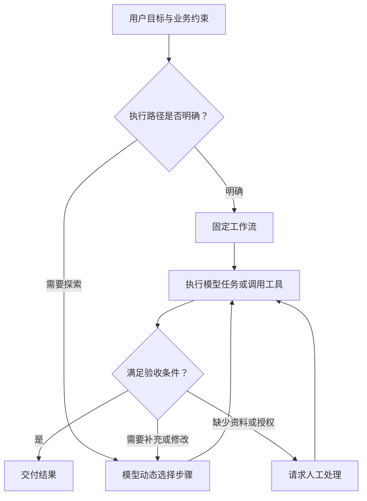

# 落地方法与场景实例 [From Business to Workflow]

**核心思想：从业务流程出发，用恰当程度的自主性，把一个真实业务流程做得更好、更快、更可靠。**

这一节把前面的概念落到实际方案设计里，用一个办公椅投标案例走通完整流程。

---

## 七、落地方法：从业务流程出发 (From Business to Workflow)

方案设计的起点是「客户哪个业务流程值得被重新设计」，之后才落到「用什么 Agent 实现」。

推荐的方案设计路径：

> Business Goal → Current Human Workflow → Task Decomposition → 哪些步骤适合 LLM → 哪些步骤需要 Tool → 哪些步骤需要 Reflection/Evaluation → 哪些步骤需要 Human Approval → 最终 Workflow

这套路径把 Agentic AI 落成了一套业务流程重构方法。

### 一个最小系统的骨架

路径明确的任务，先从固定工作流开始，动态规划按需引入。设计和排查时，用四个问题兜底：

| 问题 | 要确认什么 |
|---|---|
| 依据是什么（Evidence） | 关键结论能否追溯到资料、规则或计算 |
| 授权是什么（Authorization） | 模型可以读取什么、改变什么 |
| 完成是什么（Done） | 如何确认事情已经办成 |
| 失败怎么办（Fallback） | 何时重试、暂停或交给人工 |

---

## 八、场景实例：办公椅投标 (Case Study: Office Chair Bid)

以一份办公椅采购投标方案为例。系统首先要把资料备齐：

| 资料 | 用途 |
|---|---|
| 招标文件与采购需求（RFP & requirements） | 明确要回应什么 |
| 产品规格和检测报告（specs & test reports） | 支撑技术参数 |
| 成本、库存与供货数据（cost / inventory / supply） | 支撑报价 |
| 运输、安装和售后条件（delivery & warranty） | 支撑交付与质保 |
| 企业已批准的商务条款（approved commercial terms） | 约束承诺边界 |

按前面的思路，这个任务值得做 Agentic，因为它满足多个判断条件：多步骤（解读 → 匹配 → 报价 → 成稿）、需要外部信息（招标文件、库存、检测报告）、结果值得迭代（标书要反复检查）、能定义成功（覆盖全部强制条款、报价一致）。

一个起步方案：

> 提取招标要求 → 匹配产品 → 查询成本 → 生成草稿 → 检查缺项 → 人工确认。

最终交付除正文外，还附上参数来源、报价依据和未解决问题。涉及报价、交期、质保和法律责任的内容，由相应人员确认后再对外提交。

界面要帮助用户理解进展：展示当前任务、已完成和待处理步骤、缺少的资料或权限、需要用户决定的问题、中止原因。状态描述尽量用业务语言，例如「已完成产品匹配，仍有两项检测材料需要确认」。

---

**总结**

1. **落地从业务流程出发**：先用恰当程度的自主性，把一个真实业务流程做得更好、更快、更可靠、更经济，Agent 是手段。
2. **方案设计路径**：Business Goal → Current Human Workflow → Task Decomposition → 逐步落到 LLM / Tool / Reflection / Human Approval → 最终 Workflow。
3. **四个兜底问题**：依据是什么、授权是什么、完成是什么、失败怎么办。

---

## 引用来源

1. Andrew Ng, "How Agents Can Improve LLM Performance"（The Batch, DeepLearning.AI）— HumanEval 数据与四种设计模式。 <https://www.deeplearning.ai/the-batch/how-agents-can-improve-llm-performance>
2. Anthropic, "Building Effective Agents" — Workflow 与 Agent 的区分及工程化建议。 <https://www.anthropic.com/research/building-effective-agents>
3. Andrew Ng, "Agentic AI"（DeepLearning.AI 课程）— Module 1: Introduction to Agentic Workflows。 <https://www.deeplearning.ai/courses/agentic-ai>
