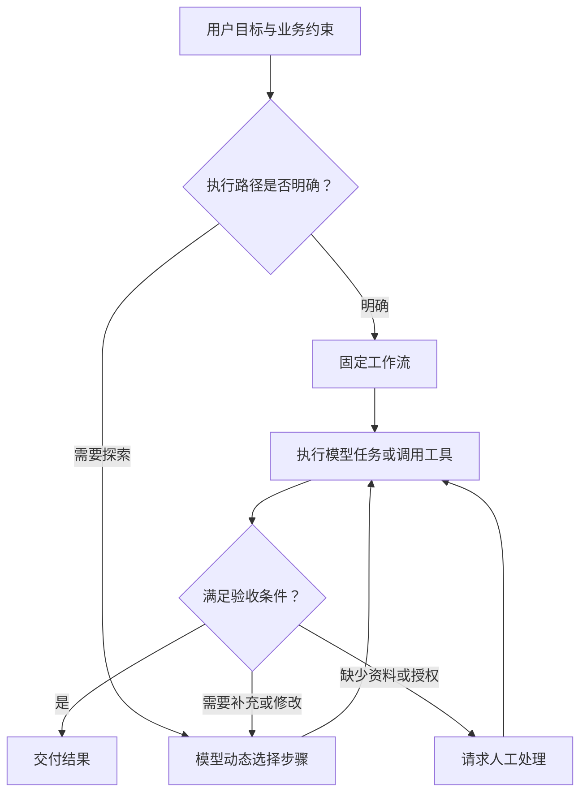

# Module 1 · Introduction to Agentic Workflows

> 基于吴恩达《Agentic AI》课程与公开资料整理，按学习主题重新编排。这一模块回答三个问题：Agentic Workflow 是什么、为什么值得投入、如何判断一个业务场景适不适合。四种设计模式（Reflection / Tool Use / Planning / Multi-Agent）只做预览，详细讲解放在后续模块。
>
> 全文以「办公椅投标」作为贯穿案例；代码与架构图用于说明设计思路。

## 目录

1. Agentic Workflow：多步骤工作流
2. 核心能力：任务分解（Task Decomposition）
3. 自主度：连续光谱（Degrees of Autonomy）
4. 四种设计模式：先掌握「什么时候用」
5. 为什么值得：扩大任务边界
6. 工程实践：Evals 与错误分析
7. 落地方法：从业务流程出发
8. 场景实例：办公椅投标
9. 本节小结
10. 引用来源

---

## 一、Agentic Workflow：多步骤工作流

最核心的一句话：

> Agentic AI = 用 LLM 驱动一个能够执行多个步骤、根据中间结果继续行动、并迭代完成目标的工作流。

它与单次生成（Single-shot）的区别在执行方式：单次生成一次性交付，Agentic 工作流则在中途观察、评估、修订，再继续。

|                        | Single-shot（单次生成）                                                          | Agentic Workflow（智能体工作流）                                                          |
| ---------------------- | ---------------------------------------------------------------------------- | --------------------------------------------------------------------------------- |
| 流程                     | Input → LLM → Output                                                          | Goal → Step 1 → Observe → Step 2 → Tool/LLM → Evaluate → Revise → … → Result |
| 修订机会                   | 无                                                                            | 有，可在中间结果上检查、修改、继续                                                                  |
| 例：研究报告                 | 一次写完                                                                         | 定目标 → 定步骤 → 搜资料 → 初稿 → 查缺口 → 补充 → 修改 → 输出                                          |

吴恩达在课程里反复引用的 HumanEval 数据，支撑的就是这个区别 [1]：

| 方案                         | HumanEval 通过率 |
| -------------------------- | ------------- |
| GPT-3.5 零样本（zero-shot）      | 48.1%         |
| GPT-4 零样本（zero-shot）        | 67.0%         |
| GPT-3.5 + agentic 工作流（最优）    | 95.1%         |

读这组数字要留意两点：95.1% 是报告中的最高值（up to），且 agentic 方案消耗了更多次调用。它说明工作流设计本身有杠杆，同时要结合成本一起评估。

### 一个更有价值的判断方式

评估一个业务任务时，更有效的问题是：

> 这个任务值不值得从一次 LLM 调用，升级成多步骤、可迭代的工作流？

它把讨论从「技术标签」拉回到「业务收益」，比「Agent / 非 Agent」的二元分类更实用。

---

## 二、核心能力：任务分解（Task Decomposition）

这一模块最值得带走的能力，是 **Task Decomposition（任务分解）**。

复杂业务目标通常难以用一个 LLM 调用可靠完成。需要把「帮我完成 X」转化成：

> X → 哪些步骤 → 每一步需要什么输入 → 每一步如何判断完成 → 哪些步骤需要工具/人工 → 哪里需要检查

例如企业市场研究，把「帮我写一份新能源汽车行业研究报告」拆成：

1. 明确研究问题
2. 确定信息缺口
3. 搜集外部资料
4. 提取关键事实
5. 形成分析
6. 检查事实和逻辑
7. 补充缺失信息
8. 生成最终报告

真正重要的是，每一个步骤都有明确职责，并且能独立判断质量。

### 任务分解的企业价值

把一个复杂任务塞进一个 Prompt，会让错误很难定位。拆成多个步骤之后：

> Step A → Step B → Step C → Step D

如果 C 出错，可以定位到 C、分析原因、单独重试或修改 C，再继续执行，无需整条链路推倒重来。

| 价值           | 说明                 |
| ------------ | ------------------ |
| 错误更容易定位      | 知道问题出在哪个步骤         |
| 局部可以重试       | 不必推倒重来             |
| 每步单独评估       | 每个步骤有自己的验收标准       |
| 不同步骤用不同模型/工具 | 复杂步骤用强模型，简单步骤用轻量方案 |
| 逐步优化瓶颈       | 哪里慢、哪里错，就优化哪里      |

一句话概括：**优化一个可观测、可评估、可迭代的工作流，效果优于打磨一个巨大的 Prompt。**

---

## 三、自主度：连续光谱（Degrees of Autonomy）

吴恩达课程把 **Degrees of Autonomy（自主程度）** 作为独立主题 [3]。它是一条连续光谱，企业里存在大量中间状态：

> 固定 Workflow → LLM 决策部分步骤 → LLM 动态规划 → LLM 自主执行更多步骤

Anthropic 用 Workflow 与 Agent 两个词区分「执行路径由代码决定」与「由模型动态决定」两类系统 [2]，这条区分能帮助定位一个场景落在光谱的哪一段。

因此，真正要回答的问题是「在这个场景里，AI 应该获得多少决策权」。

### 把自主度问题问清楚

| 问题                       | 指向       |
| ------------------------ | -------- |
| 哪些步骤可以自动化？（automate）     | 固定流程部分   |
| 哪些步骤必须由模型判断？（LLM decision） | 模型决策部分   |
| 哪些步骤只能辅助？（assist）        | 人机协作边界   |
| 哪些动作必须人工批准？（human approval） | 审批点     |
| 哪些系统允许写入？（write access）    | 写入权限     |
| 哪些动作只能读取？（read-only）       | 读取范围     |
| 什么情况下必须停止？（stop condition）  | 终止条件     |

自主度由业务风险、流程稳定性和业务价值共同决定。

---

## 四、四种设计模式：先掌握「什么时候用」

这一模块先把四种模式落成一个「什么时候用」的判断框架，完整架构放到后续模块 [1]。

| 设计模式（Design Pattern） | 解决什么问题          | 企业价值           | 对应模块     |
| --------------------- | --------------- | -------------- | -------- |
| Reflection（反思）        | 首次结果不够好         | 自动检查、修正        | Module 2 |
| Tool Use（工具使用）        | 模型自身缺乏信息/执行能力    | 访问数据、API、搜索、代码 | Module 3 |
| Planning（规划）          | 步骤复杂且不能一次完成      | 拆解并执行多步骤任务     | Module 4 |
| Multi-Agent（多智能体）     | 单个 Agent 职责过多    | 专业分工、并行协作      | Module 5 |

### 缺什么，补什么

客户提出「我们想做 Agent」时，先判断他真正缺的是哪一种能力：

- 缺信息 → Tool Use
- 缺质量控制 → Reflection
- 缺复杂流程管理 → Planning
- 缺专业分工/规模 → Multi-Agent

这比直接画一张「多 Agent 架构图」更有效。

---

## 五、为什么值得：扩大任务边界

传统 LLM 是「一次理解 → 一次生成」；Agentic 工作流是「理解 → 分解 → 获取信息 → 执行 → 检查 → 修改 → 再执行」。

因此它特别适合：

- 复杂研究
- 多步骤分析
- 知识密集型工作
- 需要外部信息的任务
- 需要多轮验证的任务
- 需要跨系统执行的业务流程

吴恩达课程把发票处理（invoice processing）、客服（customer service）、研究报告（research/report writing）列为典型应用 [3]。一个实用的判断标准是：**如果一个任务本身就要求一个熟练员工连续完成多个步骤，它通常比「一问一答」式任务更值得采用 Agentic 工作流。**

### 五个场景判断问题

| #  | 问题                            | 判断                          |
| -- | ----------------------------- | --------------------------- |
| ①  | 任务是否多步骤？（multi-step）           | 一步能完成，通常不必 Agentic           |
| ②  | 中间步骤是否需要判断？（judgment）         | 全是确定性规则，传统 Workflow 更可靠     |
| ③  | 是否需要外部信息或工具？（external data/tools） | 需实时数据/系统/搜索/计算，价值明显提高        |
| ④  | 结果是否值得迭代？（iterative gain）       | 可通过检查与修改显著提升，Reflection 很有价值 |
| ⑤  | 能否定义「成功」？（success criteria）      | 说不清「怎样算完成得好」，这个 Agent 很难做好 |

---

## 六、工程实践：Evals 与错误分析

如果这一模块只保留一条企业级原则，就是：**系统化的评测（Evals）与错误分析（Error Analysis），是有效构建 Agentic AI 的关键能力 [1]。**

效果要通过闭环来验证：

> Build → Observe → Analyze Errors → Improve → Evaluate → Repeat

### 评估的六个维度

除了「回答是否准确」，还要确认：

| 维度                  | 要确认什么                 |
| ------------------- | --------------------- |
| Task Success        | 任务到底有没有完成             |
| Quality             | 结果是否达到业务标准            |
| Reliability         | 相同任务是否稳定              |
| Safety / Compliance | 有没有越权、泄密、错误操作         |
| Cost                | 完成一次需要多少调用 / Token / 工具调用 |
| Latency             | 业务是否能接受               |

Agent 是一个系统，评估对象是整个工作流能否可靠完成业务任务，单次模型输出只是其中一个环节。

### 先观察真实失败，再建立 Evals

起步阶段先跑通、后沉淀，指标是逐步长出来的：

1. 先把 MVP 跑起来
2. 观察真实失败案例
3. 把失败归类（信息提取错误 / 工具调用错误 / 判断错误 / 输出格式错误 / 合规问题 / 不必要的调用 / 没完成任务）
4. 把高频、高风险错误变成 Eval
5. 每次改系统，重新跑

这样就形成一个可持续的 Agent Engineering Loop（工程闭环）。

---

## 七、落地方法：从业务流程出发

方案设计的起点是「客户哪个业务流程值得被重新设计」，之后才落到「用什么 Agent 实现」。

推荐的方案设计路径：

> Business Goal → Current Human Workflow → Task Decomposition → 哪些步骤适合 LLM → 哪些步骤需要 Tool → 哪些步骤需要 Reflection/Evaluation → 哪些步骤需要 Human Approval → 最终 Workflow

这套路径把 Agentic AI 落成了一套业务流程重构方法。

### 一个最小系统的骨架

路径明确的任务，先从固定工作流开始，动态规划按需引入。设计和排查时，用四个问题兜底：

| 问题             | 要确认什么             |
| -------------- | ----------------- |
| 依据是什么（Evidence） | 关键结论能否追溯到资料、规则或计算 |
| 授权是什么（Authorization） | 模型可以读取什么、改变什么     |
| 完成是什么（Done）     | 如何确认事情已经办成        |
| 失败怎么办（Fallback）  | 何时重试、暂停或交给人工      |

---

## 八、场景实例：办公椅投标

以一份办公椅采购投标方案为例。系统首先要把资料备齐：

| 资料                                | 用途      |
| --------------------------------- | ------- |
| 招标文件与采购需求（RFP & requirements）     | 明确要回应什么 |
| 产品规格和检测报告（specs & test reports）   | 支撑技术参数  |
| 成本、库存与供货数据（cost / inventory / supply） | 支撑报价    |
| 运输、安装和售后条件（delivery & warranty）  | 支撑交付与质保 |
| 企业已批准的商务条款（approved commercial terms） | 约束承诺边界  |

按前面的思路，这个任务值得做 Agentic，因为它满足多个判断条件：多步骤（解读 → 匹配 → 报价 → 成稿）、需要外部信息（招标文件、库存、检测报告）、结果值得迭代（标书要反复检查）、能定义成功（覆盖全部强制条款、报价一致）。

一个起步方案：

> 提取招标要求 → 匹配产品 → 查询成本 → 生成草稿 → 检查缺项 → 人工确认。

最终交付除正文外，还附上参数来源、报价依据和未解决问题。涉及报价、交期、质保和法律责任的内容，由相应人员确认后再对外提交。

界面要帮助用户理解进展：展示当前任务、已完成和待处理步骤、缺少的资料或权限、需要用户决定的问题、中止原因。状态描述尽量用业务语言，例如「已完成产品匹配，仍有两项检测材料需要确认」。

---

## 本节小结

这一模块最值得记住的 10 条：

1. **Agentic AI 是一种构建 LLM 应用的工作流方法**，对应多步骤、可迭代的执行方式。
2. **核心变化**：执行方式从「一次 Prompt → 一次 Output」，演进为「Goal → 多步骤执行 → 观察 → 调整 → 完成」。
3. **核心能力是任务分解（Task Decomposition）**：把复杂业务目标拆成可执行、可验证的步骤。
4. **自主度是一条连续光谱（Degrees of Autonomy）**：赋予多少决策权，由业务价值与风险决定。
5. **判断标准：这个任务值不值得升级成多步骤工作流。** 先看业务收益，再谈技术标签。
6. **四种模式先掌握「什么时候用」**：缺信息 → Tool Use；缺质量控制 → Reflection；缺流程管理 → Planning；缺分工/规模 → Multi-Agent。
7. **Reflection 提供质量控制回路（Generate → Evaluate → Improve）**，最终质量仍需 Evals 兜底。
8. **工具使用（Tool Use）让 LLM 从「生成答案」拓展到「获取信息 + 调用系统 + 执行动作」**，是业务流程自动化的起点。
9. **效果靠数据判断**：通过 Build → Observe → Error Analysis → Eval → Improve 闭环持续改进。
10. **落地从业务流程出发**：先用恰当程度的自主性，把一个真实业务流程做得更好、更快、更可靠、更经济，Agent 是手段。

---

## 引用来源

1. Andrew Ng, "How Agents Can Improve LLM Performance"（The Batch, DeepLearning.AI）— HumanEval 数据与四种设计模式。https://www.deeplearning.ai/the-batch/how-agents-can-improve-llm-performance
2. Anthropic, "Building Effective Agents" — Workflow 与 Agent 的区分及工程化建议。https://www.anthropic.com/research/building-effective-agents
3. Andrew Ng, "Agentic AI"（DeepLearning.AI 课程）— Module 1: Introduction to Agentic Workflows，含 Degrees of Autonomy、应用场景、任务分解与评测。https://www.deeplearning.ai/courses/agentic-ai
