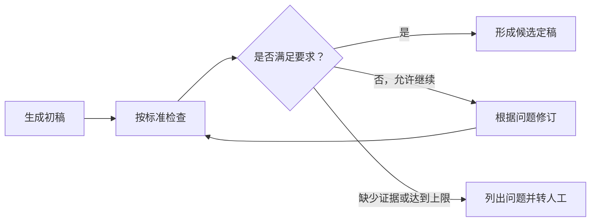
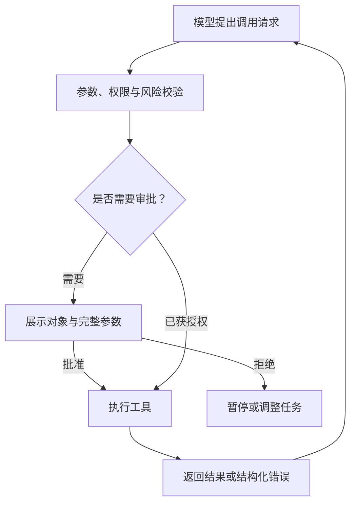
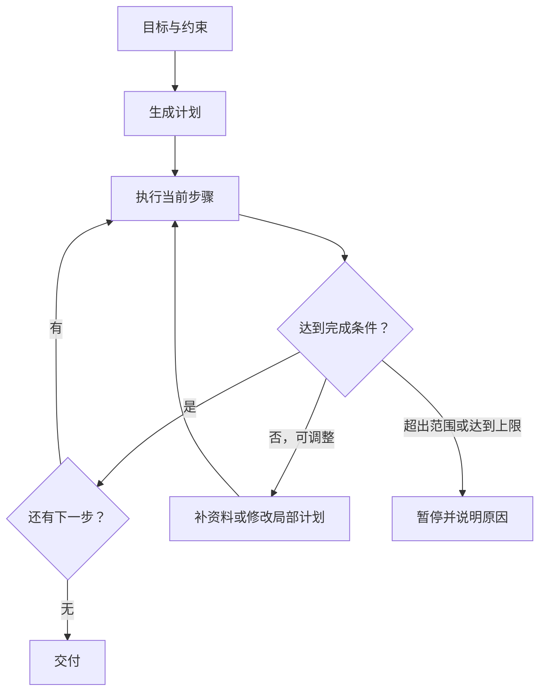
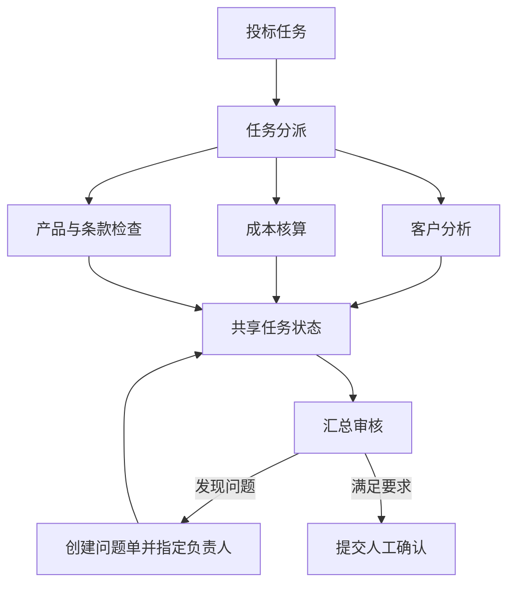
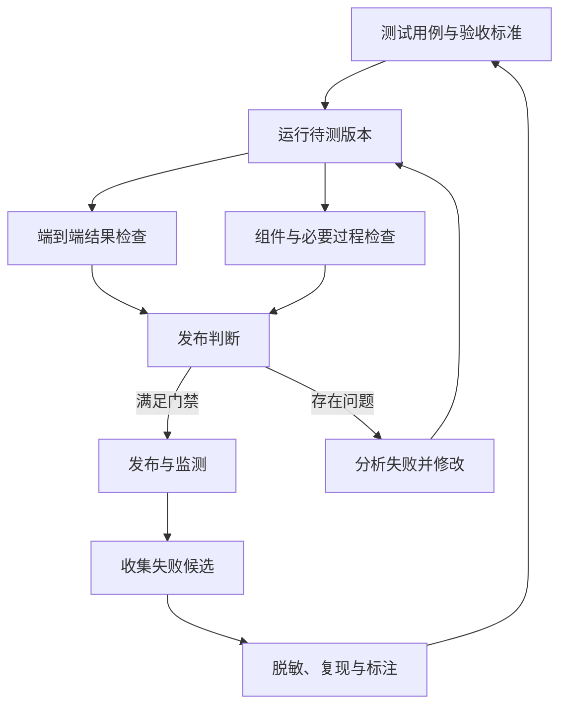

# 后续模块草稿（L2–L6）—— 保存待用，不属于 Module 1

> 本文件保存 2026-10-21 版内容中 L2（反思）、L3（工具使用）、L4（规划）、L5（多智能体）、L6（评测）的完整草稿，作为后续 Module 2–5 的素材。Module 1（Introduction to Agentic Workflows）成稿不含这些内容。
>
> 数据核实记录（2026-10-21）：L5.6 的「辩论 / 反思」两组数字已对照 arXiv:2305.14325 原文 Table 2 核实，正确。论文主设置为 3 个 agent × 2 轮、同一模型（gpt-3.5-turbo-0301）。
>
> 另：2025–2026 年有多篇论文质疑「多智能体辩论」增益主要来自多数投票而非辩论本身（Choi et al. 2025「Debate or Vote」；Zhang et al. 2025「Stop Overvaluing Multi-Agent Debate」；Bertalanič & Fortuna 2026「The Cost of Consensus」）。这些是 Module 5（多智能体）展开时必须补充的相反证据，此处先记档。

---

## L2｜反思模式：检查已有结果，再决定是否修改

### 2.1 核心概念

Reflection 是在已有结果上增加一次复核：按照明确标准找出问题，再决定是否修改。

检查对象可以是文稿、代码、工具调用结果或执行计划。常见结构是：

> 生成 → 检查 → 返回问题 → 修订。

生成与检查可以使用同一个模型，也可以分别配置。是否更换模型，不如检查标准和证据是否清楚重要。

Anthropic 将「生成器—评价器」循环列为常见工作流，并强调它适合评价标准明确、迭代收益可以判断的任务。

### 2.2 工作机制

检查环节最好给出可执行的反馈，而不是一句「还不够好」。

| 模糊反馈 | 更便于处理的反馈 |
|---|---|
| 报价不合理 | 正文金额与报价表不一致，请核对 |
| 内容不完整 | 缺少安装服务范围和交付日期 |
| 参数有问题 | 此参数未附检测报告来源 |
| 语气不专业 | 删除未经政策支持的补偿承诺 |

反思不自动带来新的事实依据。涉及金额、产品性能或条款要求时，应尽量结合规则、测试或外部资料检查。

此外，要区分两种修改：内容错误可以更正计算、引用或表达；证据缺失需要补充资料，不能靠改写补出事实。

循环需要同时考虑质量要求与资源限制。达到最大轮数、时间或成本上限后，应停止并说明剩余问题。

### 2.3 架构示意



检查不通过时，不一定总要重写。有时正确的下一步是查询资料或请求确认。

### 2.4 HCI/UX 建议

用户通常不需要阅读所有检查过程，但需要知道哪些内容被改动。

默认可以展示：「本轮修改：统一报价金额，补充安装范围，删除无依据的安全承诺。」

详细差异和证据按需展开。若支持局部修改，可以让用户锁定已确认的内容；修改影响其他段落时，再提示关联范围。

模型评分也不应被直接展示为正确概率。「检查得分 8/10」与「答案有 80% 概率正确」不是一回事。

### 2.5 代码示例

```python
draft = generate(requirements, evidence)

for _ in range(MAX_REVISIONS):
    review = check(
        draft=draft,
        criteria=criteria,
        evidence=evidence,
    )

    if review.passed:
        break

    if review.needs_more_evidence:
        return request_information(review.missing_items)

    draft = revise(draft, review.issues)

return {
    "draft": draft,
    "review_passed": review.passed,
    "open_issues": review.issues,
}
```

示例中的 `check` 可以结合代码规则、模型评分和人工判断，不必全部交给一个「审计模型」。

### 2.6 场景实例：检查投标草稿

标书初稿已经生成，检查环节发现三个问题：

1. 某项产品参数没有证据来源。
2. 正文报价与附件不一致。
3. 交货时间仍为「尽快交付」。

系统分别处理：参数来源缺失请求补充检测材料；金额不一致按已确认报价修正；交期不明确交由供应链人员确认。

这比让模型把整份标书「再优化一遍」更有针对性。

### 2.7 本节小结

反思适合发现和修正已有结果中的问题，但不保证每次修改都会改善质量。检查标准要具体，反馈要能落实；缺少事实时应补充资料，达到资源上限时应明确停止。

---

## L3｜工具使用：连接数据、计算与业务系统

### 3.1 核心概念

Tool Use 是让模型通过外部能力完成任务，例如搜索资料、查询数据库、运行计算或创建业务记录。

常见实现中，模型提出结构化调用请求，由运行时校验和执行，再把结果返回给模型。工具接口的定义与测试，是实现中的重要工作。

工具不只用于检索，也可能改变业务状态。因此，要区分「模型建议做什么」和「系统允许执行什么」。

### 3.2 工作机制

工具设计可以从四个方面检查。

| 方面 | 需要明确的问题 |
|---|---|
| 用途 | 什么时候使用，什么时候不适用 |
| 参数 | 字段含义、格式和取值范围 |
| 权限 | 谁可以调用，可以操作哪些对象 |
| 异常 | 超时、权限不足或结果缺失时如何处理 |

工具描述帮助模型选对工具，运行时负责强制校验与授权。

例如，「发送前需要确认」可以写进描述，但系统仍应检查：收件人和正文是否已被批准，执行时是否发生变化。

错误处理也要分类。临时超时可能适合重试；权限不足则应停止或请求授权。不能把「自动换工具继续」当成所有错误的默认处理。

### 3.3 架构示意



凭证应由运行时保管，不应出现在提示词、工具返回值或普通日志中。

### 3.4 HCI/UX 建议

不同操作采用不同强度的提示。

- 常规查询：展示简短状态，不必频繁打断。
- 敏感数据访问：说明访问范围和用途。
- 对外发送或重要状态变更：展示对象、内容与影响，再请求授权。
- 执行失败：说明是否重试、是否产生了部分结果，以及后续如何处理。

例如：「库存查询暂时不可用，已重试两次。尚未锁定库存，也未创建补发单。」这种说明比只显示「HTTP 429」更有用。

### 3.5 代码示例

```json
{
  "name": "get_product_cost",
  "description": "查询指定产品的成本数据，不用于修改价格或创建订单。",
  "parameters": {
    "type": "object",
    "properties": {
      "product_id": {
        "type": "string",
        "description": "企业内部产品编号"
      }
    },
    "required": ["product_id"],
    "additionalProperties": false
  }
}
```

即使参数符合结构，运行时仍需检查产品是否存在、用户是否有权访问，以及数据是否适用于当前报价。

### 3.6 场景实例：查询报价依据

成本环节查询办公椅物料、运输和安装数据，再按企业规则计算报价区间。建议将两部分分开：模型整理需求、解释结果；计算组件按明确公式处理金额。

运行代码可以减少心算错误，但不代表结果必然正确。公式、单位、输入数据和舍入规则仍需检查。

同样，发票处理可以采用「字段抽取—规则核验—订单匹配—异常分流—授权写入」的流程，而不是让模型自行决定是否合规。

### 3.7 本节小结

工具使用让模型接入外部信息和执行能力。实现时要分别处理用途描述、参数校验、权限与异常恢复。涉及写入和对外操作时，授权应由运行时落实，不能只依赖提示词。

---

## L4｜规划模式：安排步骤，并根据反馈调整

### 4.1 核心概念

Planning 解决的是「接下来怎么做」的问题。

路径明确的任务可以提前编排；只有目标、步骤尚不确定的任务，则可能需要模型在执行中安排和调整计划。

一种常见组合是：先列出计划骨架，再根据工具返回结果修改局部步骤。

### 4.2 工作机制

计划不只是步骤清单，还应包含完成条件。

| 步骤 | 交付结果 | 完成条件 |
|---|---|---|
| 提取招标要求 | 需求清单 | 保留来源位置，区分明确要求与待确认项 |
| 匹配产品 | 产品对应表 | 关键要求有证据或被标记为缺失 |
| 核算报价 | 报价依据 | 使用已确认数据与计算规则 |
| 生成标书 | 草稿 | 内容与上述结果一致 |

执行偏离预期时，先判断原因，再决定重试、补充资料、调整计划或转人工。

最大步数只能限制运行规模，不能判断方向是否正确。还需要在关键节点检查：当前动作是否仍服务于原始目标。

### 4.3 架构示意



### 4.4 HCI/UX 建议

对于耗时较长或方向不确定的任务，可以先展示计划，让用户纠正目标和范围。执行时展示具体进度，例如：「已完成 3 项检查；正在核对检测报告；等待确认交货日期。」

计划发生重要变化时，说明原因和影响：「检测报告为扫描件，增加文字识别步骤。」

注意，扫描件可以使用 OCR；密码保护文件需要合法凭据。OCR 不能用于「解密」。

### 4.5 代码示例

```json
{
  "id": "match_products",
  "goal": "将招标要求与候选产品对应",
  "inputs": ["requirements", "product_catalog", "test_reports"],
  "output": "product_requirement_mapping",
  "done_when": [
    "每项关键要求都有对应产品或缺失说明",
    "关键参数保留证据来源"
  ],
  "on_missing_evidence": "request_information"
}
```

`done_when` 是本文采用的示例字段，不是通用协议要求。

### 4.6 场景实例：投标资料不完整

系统原计划是提取要求、匹配产品、核算报价、生成草稿。匹配时发现某款产品缺少适用的检测材料，可以选择：请求产品部门补充报告；检查其他候选型号；将该要求标记为未确认，暂停相关承诺。

它不应根据「相似型号应该也符合」继续生成确定性结论。

### 4.7 本节小结

规划适合执行步骤需要根据反馈调整的任务。好的计划不仅说明做什么，还说明如何判断完成。调整计划时保留原始目标与约束，无法继续时明确暂停。

---

## L5｜多智能体协作：分配职责，管理交接

### 5.1 核心概念

Multi-Agent Collaboration 是让多个 Agent 分别承担任务的一部分，再通过交接或汇总完成目标。

它可以使用同一个模型的多个实例，也可以组合不同模型。关键是各角色是否有清楚的职责、状态和协作关系。

常见组织方式包括串行交接、并行汇总和局部交叉检查，不一定采用辩论。

### 5.2 工作机制

办公椅投标可以按职责划分：

| 角色 | 负责内容 | 交付物 |
|---|---|---|
| 客户分析 | 采购目标、使用场景与需求 | 需求清单 |
| 成本核算 | 成本、供货与服务条件 | 报价依据 |
| 产品与条款检查 | 参数证据和承诺措辞 | 检查清单 |
| 汇总审核 | 缺项、冲突与内容一致性 | 问题单与整合稿 |

分工后，还要明确：谁可以修改哪个字段；结果使用什么格式交接；发生冲突时由谁处理；哪些事项必须转人工。

多智能体会增加调用和状态管理成本。角色划分不清时，可能出现重复工作、互相等待或责任遗漏。

### 5.3 架构示意



共享状态不自动解决并发冲突。实际实现仍需版本控制、写入范围和更新规则。

### 5.4 HCI/UX 建议

用户不一定关心每个 Agent 的身份，但需要知道各部分是否完成，以及是否存在冲突。

可以展示：客户需求已整理；报价等待运输费用；产品材料缺少一份检测报告；待决事项有两种交付方案需要选择。

当结论冲突时，展示分歧与依据，而不是直接生成一个看似一致的折中答案。

### 5.5 代码示例

```json
{
  "issue_id": "issue-017",
  "type": "missing_evidence",
  "field": "delivery_date",
  "description": "标书缺少已确认的交货日期",
  "assigned_to": "supply_chain_review",
  "status": "open",
  "source_version": 3
}
```

审核角色创建问题单，不直接覆盖其他角色已经确认的数据。处理完成后，再更新状态和版本。

### 5.6 场景实例与研究提醒

在投标案例中，分析、成本和产品检查可以并行进行，但不必因此直接引入多轮辩论。

Du 等人 2023 年的多智能体辩论研究报告了以下结果（已对照原文 Table 2 核实）：

| 任务 | 单智能体 | 单智能体反思 | 多智能体辩论 |
|---|---:|---:|---:|
| 人物传记事实准确性 | 66.0% | 68.3% | 73.8% |
| MMLU 问答准确率 | 63.9% | 57.7%（降） | 71.1% |
| 国际象棋走子合法率 | 29.3% | 38.8% | 45.2% |

表中为中心值，原论文同时报告了误差范围。这些结果来自特定模型（gpt-3.5-turbo-0301）和实验设置（3 agent × 2 轮），不是对企业岗位分工或当前模型的通用保证。

更合适的理解是：收益会随任务和实现变化，需要评测，而不是预设反思或多智能体一定更好。

### 5.7 本节小结

多智能体适合职责能够有效拆分的任务。设计重点是任务边界、信息交接和冲突处理。采用前应与更简单的方案比较，确认协作带来的收益是否值得额外成本。

---

## L6｜评测：判断任务是否办成，以及哪里出了问题

### 6.1 核心概念

Evals 是用一组可重复执行的任务和评分方法，检查系统表现。

它可以帮助比较版本、发现退化和定位失败，但不能保证上线后不出问题，因此仍需生产监测和人工复核。

评测首先要区分：系统说自己完成了什么；业务环境中实际发生了什么。「回复称已补发」不等于系统中存在有效补发单。

### 6.2 工作机制

评测不必从一个庞大数据集开始，但关键成功条件应尽早明确。可以逐步建立：

1. 定义基本验收要求与安全边界。
2. 收集手工测试和历史故障。
3. 将可复现问题整理成用例。
4. 组合代码检查、模型评分与人工评审。
5. 随新失败持续补充。

| 评测方式 | 适合检查的内容 |
|---|---|
| 代码检查 | 字段、金额、数据库状态、权限与参数 |
| 模型评分 | 是否切题、解释是否清楚、结论是否有依据 |
| 人工评审 | 复杂业务判断、重要结果复核、评分校准 |

模型裁判是否合适，要通过专家样本校准，不能只按模型价格或档位决定。

### 6.3 架构示意



用户负反馈先进入候选池，经处理后再加入测试集，不应自动被当作标准答案。

### 6.4 HCI/UX 建议

界面可以展示结果的验证状态：哪些内容已经核验、哪些资料缺失、哪些结论需要人工确认、任务是否因资源或权限限制中止。

测试集通过率不等于当前回答的正确概率。与其显示来源不明的「置信度 92%」，不如写「报价计算已通过检查，交货日期尚未确认」。

### 6.5 代码示例

```python
import re

def find_blocked_names(response, blocked_names):
    return [
        name
        for name in blocked_names
        if re.search(
            rf"(?<!\w){re.escape(name)}(?!\w)",
            response,
            flags=re.IGNORECASE,
        )
    ]

hits = find_blocked_names(agent_response, ["CompCo", "RivalCo"])

metrics = {
    "blocked_name_detected": bool(hits),
    "matched_names": hits,
}
```

这段代码只能检查英文名称是否命中名单，不能代表完整的合规判断。

模型评分也最好拆开维度：事实依据（关键陈述是否得到资料或工具结果支持）、任务完成（是否回应需求并完成必要动作）、沟通质量（是否清楚、切题，避免无依据承诺）。

### 6.6 场景实例：投标方案的评测

| 层次 | 检查内容 |
|---|---|
| 最终结果 | 招标要求是否覆盖，报价和承诺是否一致 |
| 信息抽取 | 是否漏掉关键条件 |
| 产品匹配 | 型号、参数与证据是否对应 |
| 工具查询 | 数据版本与查询对象是否正确 |
| 修改环节 | 原问题是否修复，是否引入新问题 |
| 执行约束 | 是否绕过必要审批 |

过程检查应关注必要约束，不必强制所有任务使用同一条工具路径，否则可能误判合法的替代方案。

发布门禁也应区分风险：越权或泄露等问题可以单独设置硬约束；一般质量指标则结合业务要求、样本量和运行波动判断，不预设统一的退化百分比。

### 6.7 本节小结

评测既要看最终成果，也要检查关键过程和真实业务状态。从少量有代表性的用例开始，逐步补充正常、异常和边界场景。评分结果用于帮助决策，不应被当成系统可靠性的完整证明。

---

## 全章收束｜先找问题，再选模式

| 当前问题 | 优先考虑 |
|---|---|
| 缺少实时或内部信息 | 接入检索、数据库或业务工具 |
| 输出经常遗漏要求 | 明确检查项，评估是否增加反思 |
| 执行步骤事先不确定 | 引入规划与局部重规划 |
| 任务存在几类可分离职责 | 尝试多智能体分工 |
| 修改后不知道是否更好 | 建立评测与回归测试 |

这些模式可以组合，但不必全部使用。官方工程实践同样强调：先选择简单可行的方案，只有额外复杂度带来可测收益时，再继续增加。

实施时可以保留四个检查问题：依据是什么、授权是什么、完成是什么、失败怎么办。

日志记录应围绕任务状态、工具请求、执行结果、证据和版本展开，并做好脱敏与权限管理。可审计性依靠这些可观察记录，不以获取模型完整的内部思维链为前提。

一个值得投入的 Agentic 系统，不只是能连续执行很多步骤，还要让人看得懂结果来自哪里、知道哪些部分尚未确认，并能在需要时接管。
