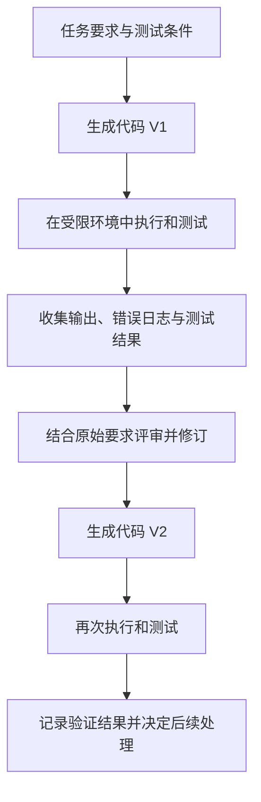
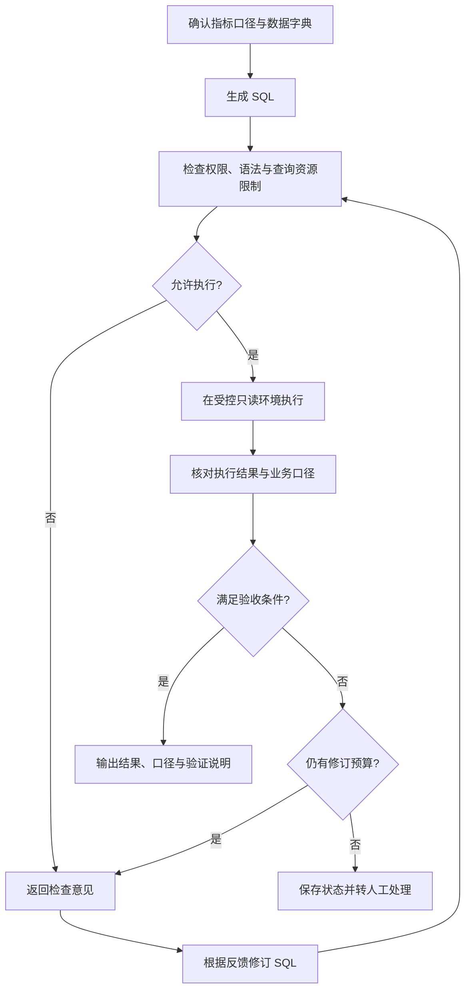

# 外部反馈与图表场景 [External Feedback and Multimodal]

**核心思想：引入模型之外的反馈让修改有据可依；图表场景靠多模态模型「看图」判断质量。**

---

## 五、外部反馈：让修改有据可依 (External Feedback)

外部反馈（External Feedback）来自模型之外，比如程序执行、测试、资料检索或人工审核 [1]。

### 代码案例中的反馈闭环

课程展示了这样的代码场景：模型生成代码，执行后出现语法错误，系统把代码、输出和错误日志交回模型，帮助它定位并修改问题 [1]。

执行环境按任务限定文件、网络、凭据和资源访问范围；修改后的代码继续接受测试。

| 反馈类型 | 能支持的判断 | 后续验证范围 |
|---|---|---|
| 语法检查结果 | 代码是否满足语法规则 | 功能与业务逻辑 |
| 执行结果 | 当前环境和输入下的运行表现 | 其他输入与异常场景 |
| 测试结果 | 已覆盖用例是否满足预期 | 测试覆盖之外的行为 |
| 数据库或 API 返回 | 外部系统返回的记录和状态 | 字段含义、数据时效与业务解释 |
| 官方资料或人工审核 | 指定事实、规则或业务判断的依据 | 来源适用范围与审核覆盖范围 |

Kamoi 等人的自我纠错综述指出，适合任务的可靠外部工具或知识能够帮助改进反馈；仅靠模型自身生成反馈的效果，受任务特征与实验设置影响 [4]。接入反馈时，先检查三个方面：信息是否可靠、与当前任务是否相关、能否支持具体修改。

反思环节要优先接入「有据可依」的反馈源（规则、工具、数据库、人工）。能接 API、能跑规则校验的场景，反思的收益才稳定；纯靠模型「再想想」的场景，收益波动大。

### SQL 查询：业务口径先行

以「查询过去一段时间销售额最高的客户」为例，生成 SQL 前先确认口径 [1]：

| 口径 | 需要确认的内容 |
|---|---|
| 时间 | 起止时间、时区与日期字段 |
| 销售额 | 订单金额、实收金额或净销售额 |
| 订单范围 | 取消、退款和测试订单的处理方式 |
| 客户维度 | 客户标识、合并规则与关联关系 |
| 排序 | 返回数量、并列名次的处理方式 |

这条流程里有两类反馈：执行反馈帮助定位语法、字段和类型问题，业务反馈帮助检查时间范围、聚合方式和关联逻辑。

---

## 六、图表场景：当结果需要「看」才能判断 (Multimodal Chart Review)

### 堆叠图和分组图的差别，不在代码里

课程提供咖啡机销售记录，比较 2024 与 2025 年第一季度的销售情况。模型生成的 Python 代码运行成功，得到第一版图表 [1]。

第一版的问题在于图表的呈现方式：它用了**堆叠柱状图**，把两个年份的数据上下叠在同一根柱子上。改用**分组柱状图**，则把两年数据并排，同一饮品的两根柱子底部对齐、顶部并列，高度差一眼就能比出来。这个差别在代码里体现不出来，只有渲染成图像后才显现。

| 形式 | 主要表达 | 对本例的影响 |
|---|---|---|
| 堆叠柱状图（Stacked Bar Chart） | 总量及其组成 | 年份数据上下叠放，比较需跨段目测 |
| 分组柱状图（Grouped Bar Chart） | 同一类别中不同系列的差异 | 两年数据并排，高度差一眼可比 |

### 把实际图像交给模型检查

多模态模型（Multimodal LLM）能同时接收图像与文本。课程把第一版代码和生成的图表一起交给模型，请它检查可读性、清晰度和完整性，并编写修订代码 [1]。

| 输入 | 检查重点 |
|---|---|
| 绘图代码 | 时间筛选、汇总过程、绘图参数 |
| 实际图像 | 图表类型、标签遮挡、图例位置、视觉布局 |

图表评审按「数据—表达—阅读」三个层次展开：

| 层次 | 检查问题 | 可能的处理 |
|---|---|---|
| 数据 | 时间、指标、汇总和单位是否一致 | 对照汇总表检查筛选与计算 |
| 表达 | 图表类型是否适合比较目标，标题图例是否清楚 | 调整图形、标题、轴标签和图例 |
| 阅读 | 字体是否清晰，标签是否重叠，布局是否拥挤 | 调整字号、间距、画布与标签位置 |

这个场景对应到产品，是数据看板、报表生成、BI 问答这类功能：它们的结果是否「达标」不能只靠程序判断，还要把渲染结果回传做视觉检查。

---

**总结**

1. **可靠且相关的外部反馈为定位问题和修订内容提供依据**，纯靠模型自我点评收益波动大，能接规则、工具、数据库的场景更稳。
2. **执行成功、测试通过和业务口径符合要求分别对应不同验收层次**，数据可读性要「看渲染结果」而不是只看代码。

---

## 引用来源

1. DeepLearning.AI，Andrew Ng《Agentic AI》Module 2 — 代码执行反馈、SQL 查询案例、图表案例与多模态评审。 <https://www.deeplearning.ai/courses/agentic-ai>
4. Kamoi et al., "When Can LLMs Actually Correct Their Own Mistakes?"（TACL 2024，arXiv:2406.01297）。 <https://arxiv.org/abs/2406.01297>
