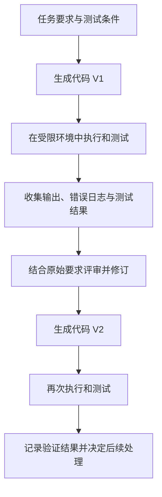
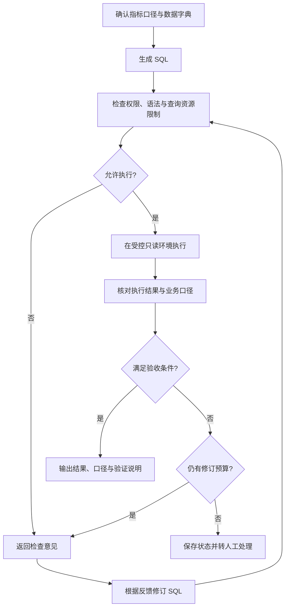

# Module 2 · Reflection Design Pattern（反思模式）

> 基于吴恩达《Agentic AI》课程 Module 2（Reflection to improve outputs of a task）整理。反思模式给输出增加一道评审：先按标准检查已有结果，再根据反馈修订。邮件、代码、SQL 和图表案例来自课程，国内云厂商的工程实现作为补充参考。

## 阅读路径

全篇沿一条主线推进，各节之间存在前后推导关系：

**反思解决什么问题 → 什么任务值得用 → 具体怎么组织 → 检查标准和分工 → 如何引入外部反馈 → 更复杂的图表场景 → 如何评估净收益 → 如何给循环设边界 → 行业如何落地。**

前四节讲「要不要用、怎么搭」，中间两节用案例把流程走通，后三节回答「怎么证明有用、怎么控制风险、怎么落到产品」。顺着这个顺序读，每一节的结论都是下一节的前提。

---

## 目录

1. 认识反思：多一道评审
2. 一次生成 vs 反思：先问值不值
3. 组织反思流程：从邮件开始
4. 检查标准与模型分工
5. 外部反馈：让修改有据可依
6. 图表场景：当结果需要「看」才能判断
7. 评估反思的影响：用数据说话
8. 结束与验收：给循环设边界
9. 国内工程实践：从课程到产品
10. 本节小结
11. 引用来源

---

## 一、认识反思：多一道评审

反思（Reflection）把生成、评审、修订串成一条流程：模型完成初稿后，结合任务要求检查已有输出，再根据反馈生成修订版。官方课程把它列为四种 Agentic 设计模式之一 [1]。

它和日常写作的复核过程相似：先把内容写完整，再检查表达、事实和遗漏。反思为工作流增加了一道明确的质量检查步骤；修改发生在推理阶段（inference），即模型生成答案的这一次处理过程，不涉及训练阶段，作用对象是当前任务的输出 \[1\]\[4]。

判断一项业务是否适合用反思，可以先看三个条件：

| 条件         | 说明          |
| ---------- | ----------- |
| 初稿存在可识别的问题 | 有具体、能指出的缺陷  |
| 质量标准能够说明   | 能把「好」翻译成检查项 |
| 修订结果能够复核   | 改完能验证是否真的变好 |

条件越清楚，这条流程越容易设计和评估。

---

## 二、一次生成 vs 反思：先问值不值

认识了反思是什么，下一个问题自然是：什么任务值得加这道检查。判断的起点，是把「一次生成」作为对照。

一次生成（Direct Generation）把需求和资料交给模型，生成结果后结束。整理内部通知、改写产品介绍这类任务，可以先从这里试起；样本测试通过，就保留这条简洁流程 [1]。

反思工作流在初稿之后增加评审和修订。三种方式的区别：

| 工作方式       | 处理过程                | 关注的问题                 |
| ---------- | ------------------- | --------------------- |
| 直接生成       | 根据需求生成结果            | 第一次输出能否达到交付要求         |
| 反思工作流      | 生成初稿，按标准检查，再修改      | 哪些问题能通过复核解决           |
| **结合外部验证** | **生成结果，调用工具验证，再修订** | **修改是否有事实、规则或执行结果支持** |

直接生成描述执行流程，零样本提示（Zero-shot Prompting）描述提示里提供的示例数量，两者可以分别设计 [2]。

### 反思一定有用吗？论文给出了两个方向

这一问决定了「反思」到底是默认能力还是按需开关，直接影响产品设计，所以先看证据。

Self-Refine 让同一个模型承担生成、反馈、修订三个角色，在推理阶段迭代；论文在七类任务上评估，摘要报告相比同模型一次生成，任务表现平均提升约 20 个百分点（绝对）[2]。这个数字是作者对七类任务的整体总结，各任务使用的指标不同，具体收益要结合模型和任务查看 [2]。

另一项研究给出了相反方向的结果。Valmeekam 等人在规划任务里用 GPT-4 同时生成和验证计划，发现自我批评反而降低了计划生成表现；引入可靠的外部验证器后，系统表现更好 [3]。

两项研究的任务、反馈方式和评价标准都不同，合起来给出两个判断依据：部分任务能从反馈修订中获益；检查结果的可靠性同样影响最终收益。

**这两条结论落在产品决策上，对应一个关键取舍**：反思适合做成「按场景开启」的能力，而不是所有功能都默认套一层。对质量要求高、且错误可被复核的任务（如标书、合规文档、数据报表），开反思往往划算；对一步就能答好、或错误难以被程序验证的任务，先保持直接生成更省。

---

## 三、组织反思流程：从邮件开始

确认了「什么任务值得用」，接下来看它具体怎么落地。最直观的入口是课程里的邮件案例。

### 邮件案例：从初稿到修订稿

课程以一封邀约邮件为例。人类检查邮件时会看三个维度 [1]：

| 检查维度  | 初稿中的情况    | 修订方向     |
| ----- | --------- | -------- |
| 时间表达  | 「下个月」范围较宽 | 补充具体可选日期 |
| 拼写    | 存在拼写错误    | 修正错误     |
| 信息完整性 | 遗漏署名      | 补充发件人姓名  |

实际工作流里，具体日期和署名来自任务输入或已确认的信息；资料缺失时，把问题整理为待确认项。

课程展示的预设流程是：先调用模型生成邮件，再调用模型完成反思与修改，评审和修订可以合并在同一次调用中 [1]。

| 调用阶段  | 输入内容               | 预期输出            |
| ----- | ------------------ | --------------- |
| 生成    | 沟通目的、收件人、已知事实、表达要求 | 邮件初稿 V1         |
| 评审并修订 | 原始要求、V1、检查标准       | 修订稿 V2 + 简要修改说明 |

一份客户邮件的反思提示词可以是：

> 请根据原始沟通要求和已知资料，检查邮件初稿。检查客户问题是否得到回应、日期和姓名是否准确、必要信息是否完整，以及承诺是否符合已提供的授权范围。保留准确内容，对有依据的问题进行修改，将资料缺口列为待确认项。输出修订后的邮件和简要修改说明；内容已符合要求时，可以保留原稿。

### 合并还是拆分

随着检查项增多，可以把反馈单独保存，再交给修订步骤。两种组织方式：

| 组织方式    | 流程                   | 适用考虑             |
| ------- | -------------------- | ---------------- |
| 合并评审与修订 | 生成 → 评审并修订           | 规则较少，流程简洁        |
| 拆分评审与修订 | 生成 → 输出评审意见 → 根据意见修订 | 需要留存问题、追踪修改、分配职责 |

**生成器—评估器循环（generator-evaluator loop）用来描述这类职责安排：生成步骤提交候选结果，评估步骤按标准给出判断，修订步骤据此调整。这个说法用于说明工作流角色，实际实现可以由同一个模型承担 [1]**。

---

## 四、检查标准与模型分工

流程串起来了，但还有一个前提没解决：评审这一环，依据什么标准、由谁执行。这是本节要回答的两个问题。

### 把业务要求转成检查项

评价标准（Review Criteria / Rubric）帮助评审步骤明确检查范围。业务应用里可以参考：

| 场景   | 可检查的内容             | 可用依据           |
| ---- | ------------------ | -------------- |
| 客户邮件 | 问题回应、事实准确性、授权承诺、语气 | 客户原文、产品资料、授权规则 |
| 解决方案 | 需求覆盖、架构一致性、交付边界    | 需求清单、官方文档、项目约束 |
| 代码生成 | 功能实现、边界处理、依赖和异常    | 需求说明、运行环境、测试结果 |
| 数据分析 | 指标口径、计算过程、结论一致性    | 数据字典、查询结果、对账记录 |

评审意见采用「问题—依据—修改建议」的结构，例如：

> 问题：邮件承诺了具体交付日期。依据：当前资料仅包含预计交付周期，具体日期待项目负责人确认。修改建议：调整为预计周期，并标注日期确认责任人。

对于字段完整性、金额计算这类可执行检查，优先用规则或程序校验；主观项设置清晰的评分说明。两类结果分别记录，便于解释修订依据。

### 按任务表现选模型组合

生成初稿和检查初稿可以用同一个模型，也可以用不同模型。吴恩达举例说明，可用推理模型（Reasoning Model）检查代码中的潜在错误 [1]。

| 配置方式      | 职责安排             | 评估重点           |
| --------- | ---------------- | -------------- |
| 同模型分阶段调用  | 同一模型分别生成、评审、修订   | 流程简单性、实际纠错效果   |
| 跨模型协作     | 不同模型承担生成、评审或修订   | 专项能力收益、额外成本与延迟 |
| 模型结合规则或工具 | 模型处理内容，程序提供可执行检查 | 反馈覆盖范围、验证可靠性   |

选型围绕真实任务样本展开：检查发现了哪些问题、修订解决了哪些问题、原有正确内容保留得怎样、调用成本是否符合预算。

**这一节的产品含义**：检查环节的「标准」和「执行者」是可以拆开配置的。产品上意味着，同一套反思能力可以针对不同业务场景挂不同的检查标准，也可以让生成用轻量模型、评审用更强的模型，用成本换质量——这是方案报价和成本估算时的一个直接杠杆。

---

## 五、外部反馈：让修改有据可依

前面几节的检查主要靠模型自己判断。但第二节已经点出一个风险：模型自查可能把对的改错。更可靠的做法，是引入来自模型之外的反馈。

### 代码案例中的反馈闭环

外部反馈（External Feedback）来自模型之外，比如程序执行、测试、资料检索或人工审核 [1]。

课程展示了这样的代码场景：模型生成代码，执行后出现语法错误，系统把代码、输出和错误日志交回模型，帮助它定位并修改问题 [1]。

执行环境按任务限定文件、网络、凭据和资源访问范围；修改后的代码继续接受测试。

### 反馈能证明什么

| 反馈类型        | 能支持的判断          | 后续验证范围         |
| ----------- | --------------- | -------------- |
| 语法检查结果      | 代码是否满足语法规则      | 功能与业务逻辑        |
| 执行结果        | 当前环境和输入下的运行表现   | 其他输入与异常场景      |
| 测试结果        | 已覆盖用例是否满足预期     | 测试覆盖之外的行为      |
| 数据库或 API 返回 | 外部系统返回的记录和状态    | 字段含义、数据时效与业务解释 |
| 官方资料或人工审核   | 指定事实、规则或业务判断的依据 | 来源适用范围与审核覆盖范围  |

Kamoi 等人的自我纠错综述指出，在其纳入研究的任务中，适合任务的可靠外部工具或知识能够帮助改进反馈；仅靠模型自身生成反馈的效果，受任务特征与实验设置影响 [4]。接入反馈时，先检查三个方面：信息是否可靠、与当前任务是否相关、能否支持具体修改。

**这条综述对应的产品原则**：反思环节要优先接入「有据可依」的反馈源（规则、工具、数据库、人工），而不是只依赖模型的自我点评。产品上体现为——能接 API、能跑规则校验的场景，反思的收益才稳定；纯靠模型「再想想」的场景，收益波动大。

### SQL 查询：业务口径先行

官方 Module 2 包含通过反思改进 SQL 生成的实验。以「查询过去一段时间销售额最高的客户」为例，生成 SQL 前先确认口径 [1]：

| 口径   | 需要确认的内容         |
| ---- | --------------- |
| 时间   | 起止时间、时区与日期字段    |
| 销售额  | 订单金额、实收金额或净销售额  |
| 订单范围 | 取消、退款和测试订单的处理方式 |
| 客户维度 | 客户标识、合并规则与关联关系  |
| 排序   | 返回数量、并列名次的处理方式  |

这条流程里有两类反馈：执行反馈帮助定位语法、字段和类型问题，业务反馈帮助检查时间范围、聚合方式和关联逻辑。空结果可能对应真实业务情况；异常结果要结合数据分布和指标口径判断。SQL 的可执行性与查询含义分别验收，修订后重新经过权限检查和结果验证。

---

## 六、图表场景：当结果需要「看」才能判断

前面的检查对象是文字、代码和查询结果，都能靠规则或程序核验。还有一种结果，质量光看代码看不出来——图表。它的可读性问题，只有看到渲染出来的图才能判断。

### 堆叠图和分组图的差别，不在代码里

课程提供咖啡机销售记录，比较 2024 与 2025 年第一季度的销售情况。模型生成的 Python 代码运行成功，得到第一版图表 [1]。

第一版的问题在于图表的呈现方式：它用了**堆叠柱状图**，把两个年份的数据上下叠在同一根柱子上。要比较同一种饮品两年的销量差异，视线需要跨过中间那一段，去目测两个起点不在同一水平线上的端点，容易看走眼。改用**分组柱状图**，则把两年数据并排，同一饮品的两根柱子底部对齐、顶部并列，高度差一眼就能比出来。这个差别在代码里体现不出来，只有渲染成图像后才显现。

| 形式                       | 主要表达         | 对本例的影响           |
| ------------------------ | ------------ | ---------------- |
| 堆叠柱状图（Stacked Bar Chart） | 总量及其组成       | 年份数据上下叠放，比较需跨段目测 |
| 分组柱状图（Grouped Bar Chart） | 同一类别中不同系列的差异 | 两年数据并排，高度差一眼可比   |

堆叠图适合表达组成关系，分组图适合比较不同系列。同理，标题是否写清、单位是否标全、图例有没有挡住数据，这些可读性问题也都要靠「看图」而不是「看代码」来判断。

### 把实际图像交给模型检查

这里就用到了多模态模型（Multimodal LLM）——它能同时接收图像与文本。课程把第一版代码和生成的图表一起交给模型，请它检查可读性、清晰度和完整性，并编写修订代码 [1]。

| 输入   | 检查重点                |
| ---- | ------------------- |
| 绘图代码 | 时间筛选、汇总过程、绘图参数      |
| 实际图像 | 图表类型、标签遮挡、图例位置、视觉布局 |

图表评审按「数据—表达—阅读」三个层次展开：

| 层次 | 检查问题                  | 可能的处理           |
| -- | --------------------- | --------------- |
| 数据 | 时间、指标、汇总和单位是否一致       | 对照汇总表检查筛选与计算    |
| 表达 | 图表类型是否适合比较目标，标题图例是否清楚 | 调整图形、标题、轴标签和图例  |
| 阅读 | 字体是否清晰，标签是否重叠，布局是否拥挤  | 调整字号、间距、画布与标签位置 |

修改意见要具体到位置和动作。一份图表评审提示词可以是：

> 你是一位数据可视化分析师。请根据原始问题、已确认的指标口径、汇总数据、绘图代码和图表图片，评审当前结果。核对时间范围、分组方式、汇总与单位是否一致；检查图表是否便于比较两个年份同类饮品的差异；检查标题、坐标轴、图例、字号、标签与布局。按「问题—依据—修改建议」列出意见，再提供修订后的 Python 代码。保留已确认的指标口径和正确内容，涉及数据逻辑的修改单独说明原因。

数据计算和视觉调整分别记录，便于检查修改有没有影响原有统计口径。

**这个场景对应到产品，是数据看板、报表生成、BI 问答这类功能**：它们的结果是否「达标」不能只靠程序判断，还要把渲染结果回传做视觉检查，才能保证交付给用户的图真的能读、能比、能下结论。

---

## 七、评估反思的影响：用数据说话

反思带来质量收益，也带来调用成本、耗时和费用。它到底值不值得保留，不能靠感觉，要靠评估。本节把前面所有案例的评估方法汇总成一套可复用的流程。

### 把两个版本放到同一套标准下

先建立直接生成的基线（Baseline），再增加反思步骤，在相同任务上比较。

| 比较条件  | 实施建议              |
| ----- | ----------------- |
| 问题与资料 | 使用相同问题、业务口径与数据快照  |
| 模型与提示 | 固定并记录版本，说明增加了哪些步骤 |
| 验收标准  | 使用相同的答案规则或评分表     |
| 运行条件  | 记录超时、重试和工具异常      |
| 资源消耗  | 同时记录调用、费用和端到端耗时   |

### SQL：核对答案，也追踪错误

课程用数据查询说明评估方法。对「哪种颜色的产品总销量最高」这类需求，两条流程分别为 [1]：

| 版本  | 处理过程                            |
| --- | ------------------------------- |
| 无反思 | 问题 → SQL V1 → 执行 → 最终回答         |
| 有反思 | 问题 → SQL V1 → 评审并修订 → 执行 → 最终回答 |

评估数据集（Evaluation Dataset）记录问题、数据版本、业务口径、参考答案和校验规则。参考答案（Ground Truth）由可信查询与人工复核确定，校验前把文本回答转换为结构化结果。

正确率反映整体变化，逐题配对结果说明变化来自哪里：

| 基线结果 | 反思后结果 | 记录含义   |
| ---- | ----- | ------ |
| 错误   | 正确    | 修复成功   |
| 正确   | 错误    | 修订退化   |
| 正确   | 正确    | 保持正确   |
| 错误   | 错误    | 问题仍待解决 |

课程中的 SQL 示例从 87% 提升到 95%，绝对提升 8 个百分点 [1]。这个数字用于说明评估方法；方案收益和对外承诺采用自身业务样本的验证结果。统计修复率和退化率时统一口径：修复率是基线错误样本中经反思变为正确的比例，退化率是基线正确样本中经反思变为错误的比例。

### 图表：数据与表达分别验收

图表同时接受程序检查和视觉评审。课程建议采用评分量表（Rubric），把要求拆成多个 0/1 判断项再汇总 [1]。

| 检查项    | 通过条件                |
| ------ | ------------------- |
| 标题     | 清楚写明指标与比较时期         |
| 轴标签与单位 | 类别、数值含义和单位完整        |
| 图表类型   | 便于比较同类饮品的年度差异       |
| 数值轴    | 范围与刻度适合当前图形和任务      |
| 可读性    | 关键文字、图例和数据可辨认，无明显遮挡 |

每项通过记 1 分，否则记 0 分并给出依据；信息不足的项目单独标记。确有程度差异的指标采用分档评分，各档配清晰说明和示例。

### 模型当裁判，裁判也要校验

模型裁判（LLM-as-a-Judge）可以承担批量初评，评分是否稳定、是否符合人工标准同样需要检查 [6]。这一节讨论的偏差，直接决定「评估分数能不能被用户信任、能不能写进对外的 SLA」，所以单独展开。

#### 位置偏差：顺序影响判断

成对比较时，模型可能受候选结果的位置影响。可采用匿名标识、交换顺序复评，并保留平局或待确认结果 [6]。

#### 自偏好偏差：更认可自己的输出

模型倾向于更认可自身或同系列模型的输出。Pombal 等人在 IFEval、LiveCodeBench 和 HealthBench 等设置下发现，即使逐条使用评分标准，这类偏差仍可能存在；多个裁判组合有所缓解，但仍有残余 [5]。Xu 等人的 ACL 2024 研究也在翻译、约束文本生成和数学推理任务中观察到自偏差，并分析了自我修订对这种偏差的影响 [7]。

| 风险或现象        | 检查与处理               |
| ------------ | ------------------- |
| 交换候选顺序后判断改变  | 匿名展示，交换顺序复评，记录平局与分歧 |
| 同样结果多次评分差异较大 | 细化标准，检查重复评分稳定性      |
| 模型倾向于认可自身输出  | 独立样本校准，增加程序或人工抽查    |
| 模型高分与业务判断不一致 | 用业务认可的正反例校准评分表      |

把「提修改建议」和「确认交付」分开：任务内反思负责定位问题、提出修改；验收负责确认结果是否达到要求。

**这一节落到产品决策，是两个明确动作**：其一，用模型裁判做批量初评可以，但分数要经过专家样本校准才能对外展示，避免把「模型打分高」直接当作「质量好」；其二，任务内的修改建议和最终的交付确认要分开，前者可以自动，后者保留独立校验或人工把关。

### 分三步决定是否采用

第一步，看有没有改善：用有代表性的业务样本比较质量，记录修复、退化和未解决问题。第二步，看值不值得投入：核算费用、耗时和人工工作量，也可以比较改进直接生成提示、补充资料或更换模型等配置。第三步，看实际运行是否稳定：进入小范围试用后，观察高峰请求、数据异常、工具超时和人工接管，明确修订预算、失败返回方式与回退方案 [1]。

| 维度   | 可记录的指标             |
| ---- | ------------------ |
| 质量   | 正确率、验收通过率、评分分布     |
| 稳定性  | 失败率、重复运行波动、修订退化    |
| 时延   | 端到端耗时，样本充分时补充分位数   |
| 费用   | 单次任务的模型、工具、重试与评估开销 |
| 人工投入 | 审核、接管与返工时间         |

---

## 八、结束与验收：给循环设边界

评估回答了「值不值得用」，但反思本质是一个循环。循环要能停下来，否则质量收益会被失控的迭代成本吃掉。本节讲怎么设边界。

### 为循环设置结束条件

| 触发条件         | 建议处理             |
| ------------ | ---------------- |
| 已满足验收标准      | 保存验证记录并结束        |
| 新版本改善了已定义指标  | 保留修订版，按预算决定后续步骤  |
| 新版本出现退化      | 保留已有较好版本，记录回退原因  |
| 连续出现同类问题     | 暂停自动修订，检查资料和检查规则 |
| 达到次数、时间或成本预算 | 返回当前状态和待解决项      |
| 事实缺失或授权边界待确认 | 转人工确认后继续         |

版本保留依据规则检查、测试和人工评审结果作出选择；保留每次变更和验证记录，有助于排查反复修改的问题。

评估时，各方案使用一致的任务要求、可用资料和验收标准；检索资料等能力同时提供给直接生成方案，使比较更贴近实际选型。在质量收益、成本和等待时间符合业务目标的任务中保留反思环节；直接生成已经满足要求的任务，采用更简洁的流程 [1]。

---

## 九、国内工程实践：从课程到产品

以上是方法论。落到真实产品里，国内云厂商已经把这些思路做成了可配置的能力。这一节从产品接口、提示词优化、工作流实现三个层次补充 \[8\]\[9\]\[10]。

### 产品接口：反思作为可配置组件

阿里云通义 UI Agent 的 PC 端接口中，反思被设计为可配置的 Agent 角色，并提供对应模型配置字段，包括是否添加反思 Agent（enable_reflector）以及反思 Agent 使用的模型（reflector_model）等 [8]。这正好印证了第四节「检查环节的标准和执行者可以拆开配置」的判断：生成、执行、评审这些职责能映射到产品接口。接口文档提供的是配置依据，质量收益仍需结合实际任务评测。

阿里云新版智能体应用（Agent 2.0）展示「规划—执行—反思」链路，记录工具调用入参与返回结果，并设置工具调用轮次上限 [8]。保留执行记录、给循环设置预算，正好对应第八节的结束条件。

### 提示词优化：区分两种修改对象

阿里云的 Prompt 自动优化文档描述利用输入输出样例和评测数据，对提示词进行多轮评估、反思和优化 [8]。这和本节讨论的运行时修订是两回事：

| 对照项  | 当前任务的输出反思  | 提示词自动优化      |
| ---- | ---------- | ------------ |
| 修改对象 | 当前邮件、代码或报告 | 后续任务使用的提示词   |
| 反馈对象 | 本次输出中的问题   | 提示词在评测样本上的表现 |
| 交付物  | 修订后的任务结果   | 优化后的提示词模板    |

**这个区分在产品上很关键**：一个是「改这一次的结果」，一个是「改以后所有任务的模板」。前者是运行时能力，后者是配置优化。客户问「反思能帮我优化什么」时，先分清他要的是哪一种，报价和交付边界完全不同。

### 工作流实现：生成器与反思器

腾讯云开发者社区的教程（deephub 发布、参与自媒体同步曝光计划）展示了完整实现：配置内容生成器，配置独立的反思器提示词，把反馈交回生成器，用 LangGraph 连接节点和状态，用条件分支结束循环 [9]。教程演示输出里出现的效率百分比、团队规模和个人经历属于示例文本，真实性需另行验证；节点、提示词结构和状态流转可以借鉴。

百度智能云的文章用三个角色解释反思流程：执行者（Actor）生成初始输出，评估者（Evaluator）检查是否符合要求，自我反思模型（Self-Reflection Model）分析问题并生成改进建议；循环在达到预期要求或迭代次数上限时结束 [10]。这篇文章适合作为概念阅读材料，涉及具体平台功能时以产品文档为准。

---

## 本节小结

1. **Reflection 把生成、评审和修订组织为可观察的工作步骤**，为输出增加一道质量检查。
2. **反思发生在推理阶段，不涉及训练**，修改的是当前任务的输出。
3. **反思适合做成「按场景开启」的能力**，质量要求高且错误可复核的任务才开，一步能答好的任务先保持直接生成。
4. **评价标准来自业务要求、已知事实和可核查的任务约束**，评审意见采用「问题—依据—修改建议」的结构。
5. **检查环节的标准和执行者可以拆开配置**，生成用轻量模型、评审用更强模型是成本换质量的直接杠杆。
6. **可靠且相关的外部反馈为定位问题和修订内容提供依据**，纯靠模型自我点评收益波动大，能接规则、工具、数据库的场景更稳。
7. **执行成功、测试通过和业务口径符合要求分别对应不同验收层次**，数据可读性要「看渲染结果」而不是只看代码。
8. **停止条件、版本保留和人工接管共同约束迭代范围**，循环不设边界会被失控的迭代成本吃掉收益。
9. **模型裁判存在位置偏差和自偏好**，评分表需要校准，分数经校准后才能对外展示。
10. **反思方案的采用取决于可验证的质量收益与成本、延迟之间的权衡**，先看有没有改善，再核算投入，最后验证运行稳定。

---

## 引用来源

1. DeepLearning.AI，Andrew Ng《Agentic AI》Module 2（Reflection to improve outputs of a task）— 反思定义、邮件案例、预设调用流程、模型分工、代码执行反馈、SQL 87%→95% 示例、图表案例与评分量表。<https://www.deeplearning.ai/courses/agentic-ai>
2. Madaan et al., "Self-Refine: Iterative Refinement with Self-Feedback"（NeurIPS 2023，arXiv:2303.17651）— 七类任务、同模型迭代，约 20 个百分点的整体实验总结。<https://arxiv.org/abs/2303.17651>
3. Valmeekam et al., "Can Large Language Models Really Improve by Self-critiquing Their Own Plans?"（arXiv:2310.08118）— GPT-4 规划、自我检查与外部验证器比较。<https://arxiv.org/abs/2310.08118>
4. Kamoi et al., "When Can LLMs Actually Correct Their Own Mistakes? A Critical Survey of Self-Correction of LLMs"（TACL 2024，arXiv:2406.01297）— 自我纠错的适用条件与可靠外部反馈。<https://arxiv.org/abs/2406.01297>
5. Pombal, Rei, Martins, "Self-Preference Bias in Rubric-Based Evaluation of Large Language Models"（arXiv:2604.06996，2026）— 逐项评分下的自偏好、测试基准及多裁判组合的局限。<https://arxiv.org/abs/2604.06996>
6. Gu et al., "A Survey on LLM-as-a-Judge"（The Innovation，2026）— 位置偏差、一致性与模型评审可靠性。<https://doi.org/10.1016/j.xinn.2025.101253>
7. Xu et al., "Pride and Prejudice: LLM Amplifies Self-Bias in Self-Refinement"（ACL 2024）— 所测任务中的自偏差与自我修订。<https://aclanthology.org/2024.acl-long.826/>
8. 阿里云官方文档：《通义 UI Agent》《新版智能体应用（Agent 2.0）》《基于大模型输入输出样例的 Prompt 自动优化》— 反思 Agent 字段、规划—执行—反思链路、提示词离线优化。
9. 腾讯云开发者社区《从零构建能自我优化的 AI Agent：Reflection 和 Reflexion 机制对比详解与实现》（deephub 发布的社区转载教程）— 生成器、反思器与条件分支的编排。
10. 百度智能云《AI Agent 的自我反思与进化之路》— 执行者、评估者与自我反思模型的职责与迭代流程。
