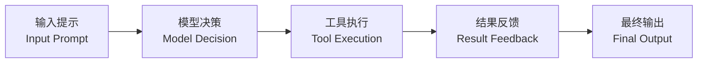

# 认识工具：模型自主调用函数 What are tools

**核心思想：工具即函数，模型自主决策。**

吴恩达在课程里把 Tool Use（工具使用）定义为：LLM 驱动的应用自主决定调用哪些函数，来完成网页搜索、访问日历、发送邮件、编写代码等任务 [1]。模型拥有**自主决策权**——它主动判断当前情境下是否需要调用工具、应该调用哪个，而不是被动地根据内部知识库生成答案。

工具（Tool）本质上就是一段普通的函数（Function）代码。开发者提供给模型，模型通过请求调用这些函数来扩展自身能力，突破训练数据和能力的限制。

| | 不用工具 | 用工具 |
|---|---|---|
| 信息来源 | 训练数据（静态、有截止时间） | 函数执行结果（实时、可访问外部系统） |
| 能做的事 | 生成文本 | 查实时数据、访问数据库、执行计算、调用 API |
| 决策权 | 无（只能基于已有知识回答） | 有（模型自主判断是否调用、调用哪个） |

---

## 一、简单工具执行流程 (Simple Tool Execution)

以"现在几点？"为例，工具使用的完整闭环：

1. **输入提示 (Input Prompt)**：用户提问 "What time is it?"
2. **模型决策 (Model Decision)**：LLM 判断自己无法提供实时时间，决定调用 `get_current_time()`
3. **工具执行 (Tool Execution)**：系统执行该函数，返回精确时间值，例如 15:20:45
4. **结果反馈 (Result Feedback)**：时间值作为新的上下文（Context）回传，写入对话历史（Conversation History）
5. **最终输出 (Final Output)**：LLM 结合新信息，生成自然语言回复 "It's 3:20pm."



整个过程的关键点：

- **工具是函数**：`get_current_time()` 是一段 Python 代码，负责与系统时钟交互并返回字符串
- **模型自主选择**：模型自行决定何时、调用哪个工具
- **动态上下文**：工具返回的结果会融入对话历史（Conversation History），供模型后续推理使用

### 何时调用，何时不调用？

工具使用的一个重要特性是**条件性调用（Conditional Tool Calling）**。模型对每个问题都盲目调工具，还是能智能判断，是衡量"智能"的关键。

- **调用工具的例子**：问"现在几点？"——模型知道需要实时数据，调用 `get_current_time()`
- **不调用工具的例子**：问"绿茶含多少咖啡因？"——模型基于内部知识库直接回答"约 25–50 mg/杯"，无需调用任何工具

这体现了模型的"智能"——它能区分哪些信息是**静态的**（已内化，可直接答），哪些是**动态的**（需外求，要调工具）。该调才调，避免浪费调用次数和延迟；该调不调则会编造答案（Hallucination，幻觉）。

---

## 二、实际应用示例 (Practical Examples)

课程给出了三个典型场景，展示不同工具如何扩展模型能力：

| Prompt（提示） | Tool（工具） | Output（输出） |
|---|---|---|
| "加州山景城附近的意大利餐厅" | `web_search(query="restaurants near Mountain View, CA")` | "Spaghetti City 是一家位于山景城的意大利餐厅…" |
| "买了白色太阳镜的顾客" | `query_database(table="sales", product="sunglasses", color="white")` | "28 位顾客购买了白色太阳镜…" |
| "存 500 美元，年利率 5%，10 年后多少钱" | `interest_calc(principal=500, interest_rate=5, years=10)` | "$814.45" |

三个例子分别对应三种工具类型：外部搜索（Web Search）、数据库查询（Database Query）、计算（Calculation）。模型面对这类请求时，内部知识不够用或会过时，工具补上了这个缺口。

---

## 三、多工具协作 (Multi-Tool Collaboration)

对于更复杂的请求，模型可以串联调用多个工具，形成工作流。

**案例：日历助理（Calendar Assistant）**

用户请求："请在周四我的日历中找一个空闲时段，并与 Alice 预约。"

提供的工具集：

- `check_calendar()`：查询日历，返回空闲时段
- `make_appointment()`：创建预约
- `delete_appointment()`：取消预约

模型执行流程：

1. 调用 `check_calendar()`，获得结果："Thursday 3pm; 4pm; 6pm"
2. 基于返回的信息，决定选择"3pm"
3. 调用 `make_appointment(time="3pm", with="Alice")`
4. 工具返回确认："Meeting created successfully!"
5. 整合信息，回复用户："Your appointment is set up with Alice at 3 PM Thursday."

```mermaid
sequenceDiagram
    participant U as 用户
    participant M as 模型(LLM)
    participant T as 工具系统
    U->>M: "周四找空闲时段并与 Alice 预约"
    M->>T: 调用 check_calendar()
    T-->>M: "Thursday 3pm; 4pm; 6pm"
    M->>M: 决策：选择 3pm
    M->>T: 调用 make_appointment(time="3pm", with="Alice")
    T-->>M: "Meeting created successfully!"
    M-->>U: "已与 Alice 约好周四 3 PM"
```

多工具协作（Multi-Tool Collaboration）的关键：模型根据前一个工具的返回结果，决定下一步调哪个工具、传什么参数。这就是工具链工作流（Tool Chaining）的基础——后续的 Planning（规划）模块会在此基础上扩展。

---

## 四、落在产品决策上

工具使用在产品里意味着什么，对应三个关键取舍：

**工具定义 = 产品能力的接口边界。** 给模型哪些工具，决定了 Agent 能做什么、不能做什么。客户问"你的 Agent 能查库存吗"——取决于你有没有接 `query_inventory()` 工具，不取决于模型能力。

**条件性调用 = 成本与延迟的控制点。** 模型每次调工具都消耗 API 调用和延迟；调错工具或多余调用会推高成本。`tool_choice` 参数（auto / required / none）是成本开关 [2]：高频简单问题设 none 走纯文本，复杂请求设 auto 让模型自判。

**多工具协作 = 工作流复杂度的来源。** 工具越多，模型选错的概率越高；工具链越长，延迟和失败点越多。100+ 工具时需要工具编排（Harness Engineering）来管理选择、监控、异常 [3]；售前报价时工具数量直接影响工程量估算。

**一个常见误解要先澄清**：LLM 本身并不直接执行工具，它只生成文本。模型输出的是"我要调用 `get_current_time()` 这个函数"的结构化请求（Tool Call），实际执行由应用层代码完成 [1][4]。这个边界在设计权限控制和异常处理时很关键——模型请求调什么，不代表系统必须执行什么。

---

**总结**

工具使用是构建下一代 AI 应用的关键技术。它让语言模型从"只会聊天"的伙伴，进化为能够"动手做事"的智能助手。

核心价值：

- **超越知识边界**：通过调用工具，模型可以获取实时数据、访问数据库、执行计算
- **实现复杂逻辑**：支持多步推理和工具链协作，处理现实世界的复杂需求
- **工具定义即产品边界**：给模型哪些工具，决定了 Agent 能做什么；客户问"能不能做 X"，答案在工具清单里，不在模型能力里
- **条件性调用是成本开关**：该调才调，避免浪费调用和延迟

---

## 引用来源

1. DeepLearning.AI，Andrew Ng《Agentic AI》Module 3（Tool use）— 工具定义、执行流程、条件性调用、日历助理案例、餐厅/数据库/利息计算示例。 <https://www.deeplearning.ai/courses/agentic-ai>
2. OpenAI Function Calling 演进（2023.6 首发 → 2023.11 升级 `tools` 参数 → 2024 并行函数调用 Parallel Function Calling → Structured Outputs）— `tool_choice` 参数（auto / required / none）控制工具调用策略。 <https://platform.openai.com/docs/guides/function-calling>
3. AI Agent Harness Engineering 工具编排——100+ 工具时的工具管理、选择幻觉、异常处理、可观测性问题。 <https://devpress.csdn.net/v1/article/detail/161174680>
4. Datawhale《agentic-ai》中文翻译版 Module 3 — "工具调用的本质：是请求，不是执行"。LLM 本身不执行工具，只生成结构化的工具调用请求（Tool Call），执行由应用层完成。 <https://github.com/datawhalechina/agentic-ai>
