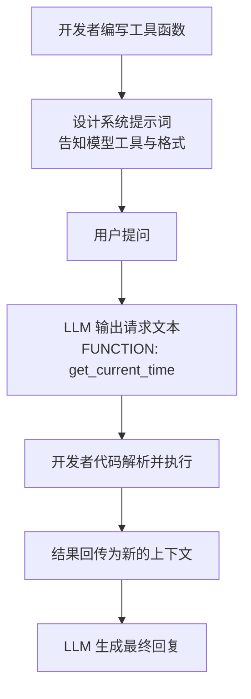

# 创建工具：从函数到工具定义 Creating a Tool

**核心思想：模型不直接调用，而是"请求"调用。**

LLM 本身并不会直接执行代码或调用函数，它被训练的核心能力是生成文本。让 LLM 学会调用函数的关键在于——模型输出的是"请求"（Request），实际执行由开发者代码完成。工具（Tool）本质上就是一些代码/函数。

如今主流的语言模型都经过直接训练去使用工具（Tool-trained LLM）；没有被训练的模型，就必须通过提示词（Prompt）来告诉它如何使用 [1]。

---

## 一、早期方法：手动提示工程 (Manual Prompt Engineering)

在 LLM 尚未被直接训练来使用工具时，开发者必须通过编写详细的系统提示词（System Prompt）来"告诉" LLM 如何请求调用工具。

以 `get_current_time` 工具为例，展示完整的交互流程：

### 步骤一：提供工具和系统提示

实现工具：开发者编写好 `get_current_time()` 函数。

设计系统提示（System Prompt），明确告知 LLM 它可以访问这个工具，并规定调用它的精确格式：

```
You have access to a tool called get_current_time. To use it, return the following exactly:
FUNCTION: get_current_time()
```

### 步骤二：用户提问与模型响应

用户提问："What time is it?"

LLM 分析问题后，意识到需要获取当前时间。根据系统提示的要求，LLM 不会直接回答，而是输出预设的触发文本：

```
FUNCTION: get_current_time()
```

### 步骤三：开发者代码介入

开发者编写的程序读取 LLM 的输出：

1. **解析输出**：检查输出中是否包含 "FUNCTION" 关键字
2. **识别意图**：提取要调用的函数名 `get_current_time` 及其参数（此例中无参数）
3. **执行工具**：程序实际调用 `get_current_time()` 函数，获得返回值（如 `"08:00:00"`）

### 步骤四：反馈结果并生成最终答案

将工具的执行结果（如 `"08:00:00"`）连同之前的对话历史（Conversation History）一起，作为新的上下文（Context）输入给 LLM。

LLM 接收到包含工具执行结果的新上下文后，知道之前发生了什么（用户问时间 → LLM 请求调用函数 → 函数返回了"8 点"），于是生成自然语言的最终回复："It's 8am."



> 这个过程就像你不能直接命令一个只会说话的人去帮你买咖啡，但你可以告诉他："如果你想去买咖啡，请说'我要买一杯美式'。"然后你听到这句话后，自己去帮他买。

---

## 二、处理带参数的工具 (Tools with Parameters)

当工具函数需要参数时，流程类似，但提示词和 LLM 的输出需要包含参数信息。

**示例：获取指定时区的时间**

实现工具：编写一个带参数的函数 `get_current_time(timezone)`。

修改系统提示：

```
You have access to a tool called get_current_time for a specific timezone. To use it, return the following exactly:
FUNCTION: get_current_time("timezone")
```

用户提问："What time is it in New Zealand?"

LLM 根据提示格式，输出带有具体参数的文本：

```
FUNCTION: get_current_time("Pacific/Auckland")
```

开发者代码解析出函数名和参数 `"Pacific/Auckland"`，调用 `get_current_time("Pacific/Auckland")`，将执行结果（如 `"04:00:00"`）反馈给 LLM，最终 LLM 回复："It's 4am in New Zealand."

| | 无参数工具 | 带参数工具 |
|---|---|---|
| 函数签名（Function Signature） | `get_current_time()` | `get_current_time(timezone)` |
| LLM 输出 | `FUNCTION: get_current_time()` | `FUNCTION: get_current_time("Pacific/Auckland")` |
| 解析难度 | 低（只提取函数名） | 中（提取函数名 + 参数值） |
| 参数来源 | 无 | LLM 从用户问题中推断 |

---

## 三、现代方法：原生工具调用 (Native Function Calling)

当前主流的 LLM 都经过了直接训练，能够原生地理解何时以及如何请求调用工具 [2]。

开发者不再需要像过去那样在提示词中硬编码特定的触发语法（如全大写的 "FUNCTION"），只需向 LLM 提供工具的描述和可用性，模型会自行决定何时调用。

| | 早期方法（手动提示） | 现代方法（原生 Function Calling） |
|---|---|---|
| 触发方式 | 系统提示词硬编码格式 | 模型原生理解工具描述 |
| 输出格式 | 自由文本（需正则解析） | 结构化 JSON（Tool Call 对象） |
| 参数解析 | 开发者手动提取 | 模型直接输出结构化参数 |
| 并行调用 | 不支持 | 支持（Parallel Function Calling） |
| 模型要求 | 任何 LLM | 需模型支持（GPT-4 / Claude / Gemini 等） |

OpenAI 在 2023 年 6 月首发 Function Calling，2023 年 11 月升级为 `tools` 参数，2024 年支持并行函数调用（Parallel Function Calling），后续推出 Structured Outputs 保证参数符合 JSON Schema [2]。

---

**总结**

工具使用的核心流程是四步循环：

1. **提供工具（Provide the Tool）**：开发者编写好功能函数
2. **告知模型（Tell the LLM）**：通过系统提示词或原生接口，告诉模型有哪些工具可用、如何请求调用
3. **解析并执行（Parse and Execute）**：开发者编写代码，监听模型的输出，识别其请求，实际执行对应的函数
4. **反馈结果（Feed Back Result）**：将函数执行的结果作为新的上下文，送回模型，让它继续推理或生成最终答案

这个流程的关键在于，开发者扮演了"翻译官"和"执行者"的角色，弥合了语言模型的文本生成能力与现实世界函数执行能力之间的鸿沟。现代原生 Function Calling 把这个流程标准化了，但四步循环的本质没有变。

---

## 引用来源

1. DeepLearning.AI，Andrew Ng《Agentic AI》Module 3（Tool use）— 创建工具、手动提示工程、带参数工具、四步循环。 <https://www.deeplearning.ai/courses/agentic-ai>
2. OpenAI Function Calling 演进（2023.6 首发 → 2023.11 升级 `tools` 参数 → 2024 并行函数调用 Parallel Function Calling → Structured Outputs）— 原生工具调用与 JSON Schema 参数校验。 <https://platform.openai.com/docs/guides/function-calling>
