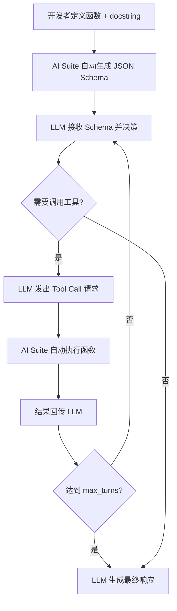

# 工具调用语法 Tool Use Syntax

**核心思想：LLM 不直接调用工具，而是"请求"开发者去调用。**

LLM（大语言模型）本身不会直接调用工具。它会"请求"开发者去调用某个工具，开发者负责执行该工具并将其结果返回给 LLM。在开发社区中，人们常简化说"LLM 调用了工具"，但这在技术上并不准确，仅是一种便捷的说法 [1]。

---

## 一、AI Suite 库 (AI Suite Library)

AI Suite 是一个开源库，由 Andrew Ng 及其团队开发。它提供了一种统一、简便的语法来调用多个不同的 LLM 提供商（如 OpenAI）。该库的核心功能之一是**自动处理工具描述**，极大简化了开发流程 [1]。

以 `get_current_time` 函数为例，使用 AI Suite 调用工具的基本代码框架：

```python
import aisuite as ai

client = ai.Client()
response = client.chat.completions.create(
    model="openai:gpt-4o",      # 指定使用的模型
    messages=messages,           # 传递给 LLM 的消息数组
    tools=[get_current_time],    # 定义 LLM 可以访问的工具列表
    max_turns=5                  # 设置工具调用的最大轮次，防止无限循环
)
```

参数解析：

- **model**：选择要使用的 LLM，此处为 OpenAI 的 `gpt-4o`
- **messages**：传递给模型的对话历史（Conversation History）或提示信息
- **tools**：最核心的参数。只需将你希望模型能访问的函数对象（如 `get_current_time`）放入一个列表中即可
- **max_turns**：设置一个上限，防止模型在工具调用上陷入无限循环。通常设为 5 即可，除非任务异常复杂

AI Suite 的语法与 OpenAI 原生 API 非常相似，但提供了更高的抽象层，使得开发者可以专注于业务逻辑，而非繁琐的 API 细节。它还支持轻松切换多个 LLM 提供商 [1]。

---

## 二、AI Suite 如何自动化工具描述 (Automatic Tool Description)

AI Suite 的强大之处在于其自动化能力——它能将你的 Python 函数无缝转换为 LLM 可理解的格式。

当你将 `get_current_time` 函数传入 `tools` 参数后，AI Suite 会在后台自动为其生成一个 JSON Schema（JSON 模式）。这个 Schema 是传递给 LLM 的真实数据结构：

```json
{
  "type": "function",
  "function": {
    "name": "get_current_time",
    "description": "Returns the current time as a string",
    "parameters": {}
  }
}
```

自动生成过程：

| 字段 | 来源 |
|---|---|
| **name**（函数名） | 直接提取 Python 函数的名称 |
| **description**（函数描述） | 自动从函数的 docstring 中提取 |
| **parameters**（参数） | 对于无参函数，此部分为空对象 `{}` |

开发者只需写好函数和 docstring（文档字符串），AI Suite 自动完成从 Python 函数到 JSON Schema 的转换。

---

## 三、处理带参数的函数 (Functions with Parameters)

当函数需要参数时，AI Suite 能自动识别参数类型并纳入 Schema。

工具定义：

```python
from datetime import datetime
from zoneinfo import ZoneInfo

def get_current_time(timezone):
    """Returns current time for the given time zone"""
    timezone = ZoneInfo(timezone)
    return datetime.now(timezone).strftime("%H:%M:%S")
```

AI Suite 自动生成的 JSON Schema：

```json
{
  "type": "function",
  "function": {
    "name": "get_current_time",
    "description": "Returns current time for the given time zone",
    "parameters": {
      "timezone": {
        "type": "string",
        "description": "The IANA time zone string, e.g., 'America/New_York' or 'Pacific/Auckland'."
      }
    }
  }
}
```

AI Suite 不仅能提取函数名和描述，还能识别出 `timezone` 参数，并将其类型（`string`）和详细说明一并纳入 Schema。这样，当 LLM 决定调用此函数时，它就知道需要提供一个类似 `'America/New_York'` 的字符串作为参数。

| | 无参数函数 | 带参数函数 |
|---|---|---|
| JSON Schema parameters | `{}`（空对象） | 含参数名、类型、描述 |
| LLM 需要提供 | 无 | 参数值（如 `"Pacific/Auckland"`） |
| docstring 要求 | 函数描述即可 | 需写清参数说明 |

---

## 四、完整工作流程 (End-to-End Workflow)

从开发者定义函数到 LLM 生成最终响应，完整流程如下：

1. **开发者定义函数**：编写一个带有清晰 docstring（文档字符串）的 Python 函数
2. **AI Suite 自动封装**：调用 `client.chat.completions.create` 时，AI Suite 自动读取函数信息，生成标准的 JSON Schema
3. **LLM 接收并决策**：LLM 接收到包含所有可用工具描述的 Schema，根据当前对话上下文（Context）和用户需求，决定是否需要调用某个工具
4. **LLM 发出请求**：如果需要，LLM 生成一个包含工具名称和所需参数的请求（Tool Call）
5. **开发者执行工具**：AI Suite 的客户端接收到 LLM 的请求后，自动调用开发者定义的对应函数，并传入指定的参数
6. **结果返回与迭代**：函数执行的结果送回 LLM，LLM 基于此新信息继续思考，甚至发起下一次工具调用。整个过程最多可重复 `max_turns` 次
7. **最终响应**：当所有轮次结束或 LLM 决定不再调用工具时，生成最终的文本响应返回给用户



---

## 五、代码执行工具 (Code Execution Tool)

课程还提到一类特殊工具——代码执行工具（Code Execution Tool）。与其他工具不同，它赋予 LLM 几乎无限的可能性，因为代码本身可以完成任何计算、数据处理或外部交互任务。

通过提供这个工具，开发者实际上是在告诉 LLM："你可以让我为你执行任何你认为必要的代码。"这极大地扩展了 LLM 的能力和应用场景 [1]。

> 代码执行工具的详细内容在后续章节单独展开，本节只做概念引入。

---

**总结**

工具调用语法的核心在于：

- **LLM 请求，开发者执行**：LLM 不直接调用工具，只生成结构化的工具调用请求（Tool Call），执行由应用层完成
- **AI Suite 自动化**：开发者只需写好 Python 函数 + docstring，AI Suite 自动生成 JSON Schema，无需手动描述工具格式
- **JSON Schema 是桥梁**：它是 Python 函数与 LLM 之间的标准通信格式，包含函数名、描述、参数类型
- **max_turns 控制循环**：防止模型在工具调用上陷入无限循环，通常设为 5
- **代码执行工具是终极扩展**：让 LLM 能执行任意代码，能力边界几乎无限

---

## 引用来源

1. DeepLearning.AI，Andrew Ng《Agentic AI》Module 3（Tool use）— AI Suite 库、自动化工具描述、JSON Schema 生成、带参数函数、完整工作流程、代码执行工具概念。 <https://www.deeplearning.ai/courses/agentic-ai>
