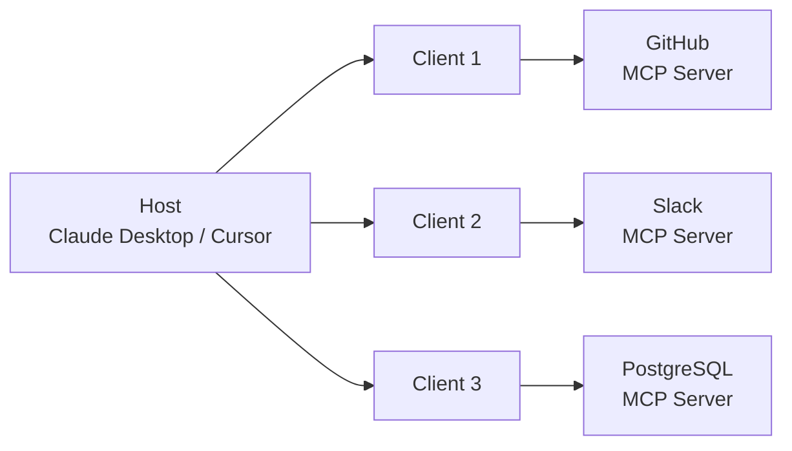

# MCP：模型上下文协议 Model Context Protocol

**核心思想：把工具集成从 m × n 降到 m + n。**

MCP（Model Context Protocol，模型上下文协议）是一个开放标准，为 LLM 提供标准化的方式来访问外部工具和数据源。它解决一个痛点：开发者在构建智能体应用时，需要为每个应用重复编写代码来集成不同工具（如 Slack、GitHub、Google Drive 等）[1]。

> 用户笔记中提到"由 Entropy 提出"——实际是 **Anthropic** 于 2024 年 11 月开源提出 [2]。2025 年 12 月 Anthropic 将 MCP 捐给 Linux Foundation 旗下的 Agentic AI Foundation，不再属于单一公司 [3]。

---

## 一、它解决什么问题 (The Problem)

**传统开发模式**：

- 开发者 A 构建 App 1，需要集成 Slack、Google Drive、GitHub 和 PostgreSQL
- 开发者 B 构建 App 2，同样需要集成这些工具
- 每个应用都独立编写封装代码来调用各个工具的 API
- 如果有 m 个应用和 n 个工具，整个社区的工作量是 **m × n**，效率低下

**MCP 的解决方案**：

引入共享服务器——应用程序通过一个共享的 MCP 服务器来访问工具和数据源：

- 只需开发 n 个 MCP 服务器（每个对应一个工具）
- 让 m 个应用去连接这些服务器
- 整个社区的工作量从 **m × n 降低到 m + n**

| | 传统模式 | MCP 模式 |
|---|---|---|
| 工作量 | m × n（每个应用×每个工具都要写封装） | m + n（应用连一次，工具封装一次） |
| 新增应用 | 要为每个工具重新写封装 | 连接已有 MCP 服务器即可 |
| 新增工具 | 每个应用都要更新封装 | 写一个 MCP 服务器，所有应用即插即用 |

> 常被比作 USB-C——一个接口接所有设备 [3]。

---

## 二、核心组件 (Core Components)

MCP 采用 Host-Client-Server 三层架构，基于 JSON-RPC 2.0 通信 [2]：

### 客户端 (Clients)

- **角色**：希望访问外部工具或数据的应用程序
- **示例**：Cursor、Claude Desktop、Windsurf
- **功能**：向 MCP 服务器发送请求，获取数据或执行操作
- 每个 Client 与一个 Server 维持 1:1 的会话连接 [2]

### 服务器 (Servers)

- **角色**：提供工具和数据源的软件服务
- **示例**：Slack、Google Drive、GitHub、PostgreSQL
- **功能**：作为"包装器"，接收客户端请求，转换为对原始工具 API 的调用，返回结果
- **来源**：部分由服务提供商开发，大量由第三方开发者贡献
- 截至 2025 年 12 月，公开运作中的 MCP Server 超过一万个 [3]

### 服务器可提供三类原语 (Primitives)

| 原语 | 驱动方 | 说明 |
|---|---|---|
| **Tools**（工具） | 模型 | 模型可调用的函数，如 `create_ticket`、`search_web` |
| **Resources**（资源） | 应用 | 可读取并加载到上下文中的数据，如文件、数据库表结构 |
| **Prompts**（提示模板） | 用户 | 可复用的指令模板，如"审阅这份 Pull Request" |

> 实际使用中，大多数服务器只提供 Tools，这也是人们通常所说的"MCP" [3]。

---

## 三、实际演示：Claude Desktop + GitHub MCP Server

**场景**：用户在 Claude Desktop 中输入："总结该 GitHub 仓库的 README 文件内容"，并附上 URL。

**流程**：

1. Claude Desktop（MCP 客户端）识别到需要访问 GitHub
2. 向已连接的 GitHub MCP 服务器发送请求，参数包含文件路径（README.md）、仓库名（aisuite）、所有者（andrewng）
3. GitHub MCP 服务器执行请求，从仓库下载文件内容
4. 服务器将长文本响应返回给 Claude Desktop
5. Claude Desktop 将内容反馈给 LLM，LLM 生成简洁的摘要

**第二次查询**："有哪些最新的 Pull Request？"

1. 客户端向服务器发送"List pull requests"请求
2. 服务器返回 JSON 格式的拉取请求列表
3. LLM 整理成清晰列表，包括标题、状态、作者和描述

---

## 四、能力范围与安全 (Capabilities & Security)

### 能力演进

MCP 初始设计侧重于为 LLM 提供更多上下文，工具主要用于"获取数据"（Fetch Data）。当前能力已扩展，涵盖数据访问、通用功能调用和操作执行 [1]。在 MCP 文档中，这些统称为"资源"（Resources）[2]。

### 安全原则

MCP 赋予了应用通过任意数据访问和代码执行路径的强大能力，伴随而来的是重要的安全和信任考量 [2]：

| 原则 | 说明 |
|---|---|
| **用户同意与控制** | 用户必须明确同意并理解所有数据访问和操作；保留对共享数据和执行操作的控制权 |
| **数据隐私** | Host 在向服务器暴露用户数据前必须获得明确同意；不得在未经同意下传输数据 |
| **工具安全** | 工具代表任意代码执行，须谨慎对待；Host 在调用任何工具前必须获得用户同意 |
| **服务器隔离** | 服务器只能看到必要的上下文信息，完整对话历史留在 Host 端；服务器之间互相隔离 |

> 模型本身从不执行任何操作，它只生成一项请求。是否执行由 Host 程序决定，通常会先征求用户确认 [3]。

---

**总结**

MCP 是工具使用领域的标准化革命：

- **从 m × n 到 m + n**：工具集成成本从"每个应用×每个工具"降到"应用连一次+工具封装一次"
- **Host-Client-Server 三层架构**：Host 管协调，Client 管连接，Server 管工具能力
- **三类原语**：Tools（模型调用）、Resources（数据读取）、Prompts（提示模板）
- **生态活跃**：2025 年 12 月已有超一万个公开 MCP Server，协议已捐给 Linux Foundation
- **安全优先**：用户同意、数据隐私、工具安全、服务器隔离四条原则
- **USB-C 类比**：一个接口接所有设备——MCP 就是 AI Agent 世界的 USB-C

---

## 引用来源

1. DeepLearning.AI，Andrew Ng《Agentic AI》Module 3（Tool use）— MCP 定义、问题与解决方案、核心组件、能力范围、Claude Desktop + GitHub MCP 演示。 <https://www.deeplearning.ai/courses/agentic-ai>
2. Model Context Protocol 官方规范（2025-11-25 版）— Host-Client-Server 架构、JSON-RPC 2.0、三类原语、能力协商、安全原则。 <https://modelcontextprotocol.io/specification/2025-11-25/architecture>
3. MCP 行业资料 — Anthropic 2024.11 开源提出，2025.12 捐给 Linux Foundation 旗下 Agentic AI Foundation；超一万个公开 MCP Server；USB-C 类比。 <https://followmcp.com/zh/glossary/mcp>
