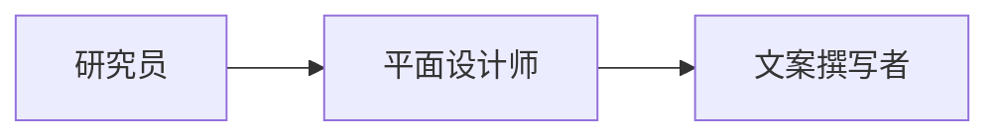
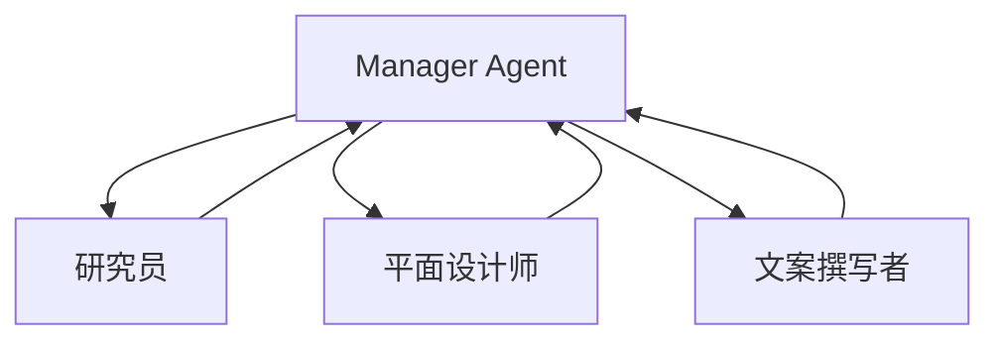
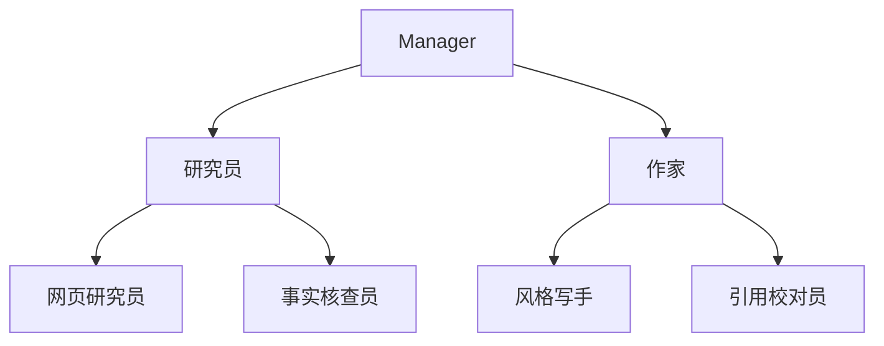
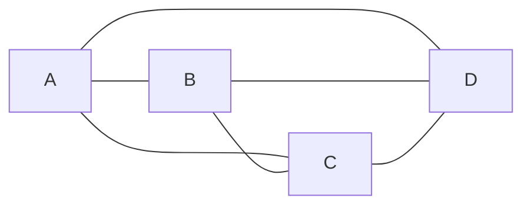
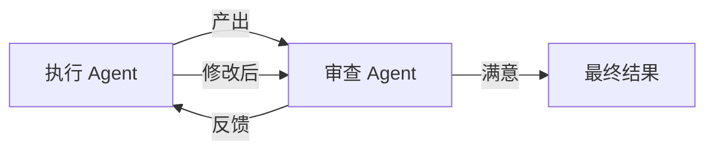

# 多智能体系统的协作模式 Communication patterns for multi-agent systems

**核心思想：选对通信模式比堆 Agent 数量重要——架构和任务对齐，比团队大小重要得多。**

当一个团队一起工作时，他们之间的沟通模式可能非常复杂。设计多智能体系统的通信模式也同样复杂，而组织结构的好坏会极大影响系统的效率与结果。

本节基于上一节的市场调研 Agent，介绍四种协作模式：线性、双层、多层、去中心，外加第五种对话模式。

---

## 一、线性模式 (Linear)

像一个市场团队的工作流：研究员 → 平面设计师 → 文案撰写者。每个人只和下一个环节沟通。

- **结构**：按顺序执行，信息单向流动
- **优点**：结构简单、易于理解、结果可预测
- **缺点**：不灵活，出错时难以反馈或修正
- **适用**：固定流程任务（先调研、再设计、最后撰写）

> 生产里见过太多团队一上来就堆复杂的协作模式，结果 5 个 Agent 互相 hand off 200 轮，token 烧光却没出活——根因就是任务本身是线性可拆的，根本不需要复杂结构 [1]。

---

## 二、双层模式 (Hierarchical)

有一个"管理员 (Manager Agent)"负责协调所有下属 Agent。就像项目负责人依次给研究员、设计师、写手分配任务，收集结果，再整合。

- **结构**：所有通信都经过 Manager，下属 Agent 之间不直接沟通
- **优点**：清晰、易于控制、任务协调性强
- **缺点**：Manager 可能成为瓶颈（负担重）
- **适用**：多任务协调、需要统一审计的场景

这是当前生产环境出现频率很高的范式，Anthropic 的 Claude Research、OpenAI Agents SDK 的 Agent.as_tool() 都属于这类 [2]。Manager 负责拆任务、派活、汇总；每个子 Agent 有独立上下文窗口和工具，互不干扰。

---

## 三、多层模式 (Deep Hierarchy)

一些高级系统让子 Agent 自己也拥有下属 Agent。例如"研究员"下面有"网页研究员"和"事实核查员"，"作家"下面有"风格写手"和"引用校对员"。

- **结构**：树状层级，指令自上而下拆解，结果自下而上汇总
- **优点**：可扩展、模块化、可分层调度
- **缺点**：通信复杂、难以调试、出错难追踪
- **适用**：极其庞大且复杂的任务，需要层层分解

Claude Code 的子 Agent 可以再调用自己的子 Agent，默认最多 3 层；Cursor 在 2026 年 2 月的 2.5 版也允许执行者再调用执行者 [2]。层数越多，token 和等待时间越多，必须事先定好深度上限。

---

## 四、去中心模式 (All-to-all)

每个 Agent 都能随时与其他 Agent 交流，没有中心，也没有固定顺序。每个 Agent 都知道其他 Agent 是谁，可以互相发消息，谁都可以决定何时回复。直到最后大家都"认为任务完成"时，产出最终结果。

- **结构**：完全去中心化，扁平网络，全双向通信
- **优点**：高度灵活、创意性强、多视角交叉验证
- **缺点**：难以预测结果、通信开销大、token 重复高
- **适用**：容忍一定混乱、追求创造性结果的场景（头脑风暴、辩论、创意生成）

Multi-Agent Debate 的研究报告称，这种模式能提升回答的事实性和推理质量 [2]。但如果 Agent 数量过多，容易导致信息过载和沟通效率低下。

---

## 五、四种模式对比

| 模式 | 结构特征 | 优点 | 缺点 | 适用场景 |
|---|---|---|---|---|
| **线性** | 顺序执行，单向通信 | 简单、可预测 | 不灵活 | 固定流程任务 |
| **双层** | 中心协调 | 易控制、协调性强 | Manager 成瓶颈 | 多任务协调 |
| **多层** | 子 Agent 层次化 | 模块化、可扩展 | 复杂、难调试 | 大型系统 |
| **去中心** | 自由对话 | 创造性强、多视角 | 不可预测、开销大 | 探索型、生成型任务 |

---

## 六、第五种：对话模式 (Conversational)

四种模式之外，还有一种对话模式，类似去中心模式的降级版。每次只有两个 Agent 互相对话，一方执行任务，另一方审查任务，最终交出一份双方都满意的结果。

- **结构**：两轮交互，执行 → 审查 → 修改 → 再审查，直到双方满意
- **优点**：比去中心可控，质量有保障（有人审查）
- **缺点**：只有两方视角，可能遗漏其他角度的问题
- **适用**：代码生成 + 代码审查、文章撰写 + 编辑审稿

这对应 Anthropic/OpenAI 归纳的 Evaluator-Optimizer 模式 [3]：生成者产出 → 评估者检查 → 反馈给生成者修改 → 循环直到通过。

---

## 七、实际生产中的选择

**线性模式和双层模式更常用。** 原因很实际：当前 LLM 的能力下，信息会在层级之间传递时丢失部分内容，层级越多，信息越匮乏、越失真。多层和去中心模式虽然理论上更强大，但调试难度和 token 成本也成倍上升。

UC Berkeley 的研究从 7 个主流多 Agent 框架收集了 1,642 条执行轨迹，建立了系统性失败分类框架 (MAST)，识别出 14 种细粒度失败模式 [4]。其中**系统设计问题占 44.2%**，是最主要的失败根因——架构没选对，比 Agent 数量不够严重得多。

Anthropic 自己也踩过坑：早期版本允许 lead agent 给出模糊指令（如"研究半导体短缺"），结果三个子 Agent 做了重复的搜索。后来改成每张任务书都要有明确目标、输出格式、可用工具、任务边界，重复劳动才消失 [5]。

> 选型原则：不确定就从双层模式开始。它既能处理相对复杂的协调工作，保持流程可控，又比去中心模式稳定。任务非常简单且步骤固定就简化为线性模式 [6]。

---

## 八、框架对应关系

| 框架 | 偏好的通信模式 | 特点 |
|---|---|---|
| **LangChain** | 线性（StateGraph） | 忠实的线性结构，图编排能力强 |
| **smolagents** | 双层 / 多层 | 轻量，子 Agent 机制简洁 |
| **LangGraph** | 双层（Supervisor）+ 线性（StateGraph） | 两种都支持，按场景选 |
| **AutoGen** | 去中心（GroupChat）+ 对话 | 多 Agent 对话框架，支持辩论 |
| **MetaGPT** | 去中心 | 模拟社会角色分工与协作规则 |
| **CAMEL-AI** | 去中心 | 角色扮演式多 Agent 协作 |
| **CrewAI** | 线性（Sequential）+ 双层（Hierarchical） | 两种都支持 |
| **OpenAI Agents SDK** | 动态交接（Handoff）+ 双层 | Agent Transfer 路由 |

大部分框架都可以同时实现多种结构，只是代码风格不同。多尝试，找到最适合具体任务的框架 [7]。

---

## 九、课程总结

到这里，四大 Agentic 设计模式全部讲完了：

| 模式 | Module | 核心能力 |
|---|---|---|
| **Reflection（反思）** | Module 2 | 先做，再检查，再改 |
| **Tool Use（工具使用）** | Module 3 | 调用外部工具扩展能力 |
| **Planning（规划）** | Module 5.1-5.3 | 先拆步骤，再按顺序执行 |
| **Multi-Agent（多智能体）** | Module 5.4-5.5 | 分角色协作，各司其职 |

加上 Module 4 的实用技巧（评估 / 错误分析 / 组件级评估 / 改进方法 / 成本延迟优化），一套完整的 Agentic AI 开发方法论就成型了。Andrew Ng 在课程里反复强调：**能否进行严格、有纪律的评估，是区分"做得好"与"做得差"的最大预测因素。** 设计模式是手段，评估和迭代才是核心。

---

**总结**

- 四种通信模式：线性（简单不灵活）/ 双层（易控 Manager 瓶颈）/ 多层（模块化复杂）/ 去中心（创造性不可预测）
- 第五种对话模式：执行 + 审查两方对话，对应 Evaluator-Optimizer，质量有保障
- 生产中线性 + 双层更常用：层级越多信息丢失越严重，多层和去中心调试难度和成本成倍上升
- UC Berkeley MAST 框架：14 种失败模式，系统设计问题占 44.2%——架构没选对比 Agent 不够严重
- Anthropic 教训：模糊指令导致子 Agent 重复探索，任务书必须明确目标/输出格式/工具范围/边界
- 不确定就从双层开始，任务简单固定就简化为线性
- 框架选型：LangChain 线性 / smolagents 双层 / AutoGen 去中心 / MetaGPT CAMEL 去中心 / CrewAI 两种都支持

---

## 引用来源

1. 多 Agent 协作编排模式——四大范式（主管-专家/流水线/并行群智/动态交接）适用场景对比、"5 个 Agent 互相 hand off 200 轮 token 烧光"的真实案例。 <https://www.qiqicto.com/infor/7815.html>
2. 多智能体全景指南——五种模式（编排者-执行者/移交/层级/对等/流水线）、Claude Code 子 Agent 默认最多 3 层、Cursor 2.5 允许执行者再调用、Multi-Agent Debate 提升事实性。 <https://arte.itlibra.com/zh/articles/what-is-multi-agent>
3. Anthropic/OpenAI Agent 拓扑——五种通信模式（Chain / Routing / Parallelization / Orchestrator-Workers / Evaluator-Optimizer）、各模式适用场景。 <https://ithelp.ithome.com.tw/articles/10422806>
4. Multi-Agent 系统生产挑战——UC Berkeley MAST 框架（1,642 条轨迹、14 种失败模式、系统设计问题占 44.2%）、OpenAI Codex role 定义原则（narrow and opinionated）。 <https://developer.cloud.tencent.cn/article/2638304>
5. Anthropic《How we built our multi-agent research system》——早期模糊指令导致子 Agent 重复探索、任务书必须明确目标/输出格式/工具范围/边界。 <https://www.anthropic.com/research/multi-agent-research-system>
6. 吴恩达 Agentic AI Module 5——四种通信模式（线性/双层/多层/去中心）+ 第五种对话模式、实际生产中线性+双层更常用、信息层级传递丢失。 <https://www.deeplearning.ai/courses/agentic-ai>
7. 框架对应关系——LangChain 线性 / smolagents 双层多层 / MetaGPT CAMEL 去中心 / CrewAI Sequential+Hierarchical / OpenAI Agents SDK Handoff。 <https://opc.csdn.net/6a80195f10ee7a33f29b46af.html>
